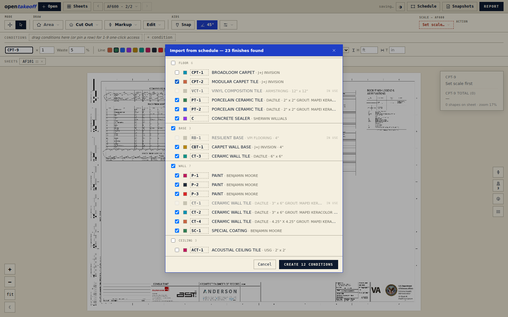
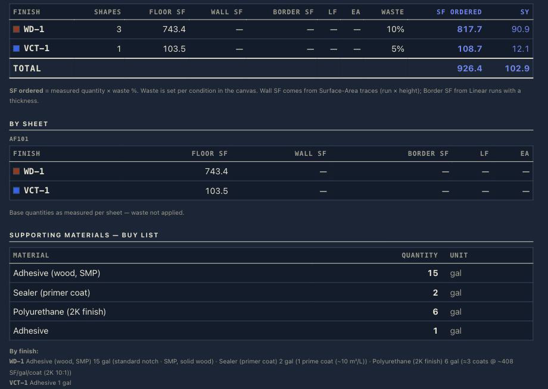

# OpenTakeoff — The User Manual

The empty Plan Set landing page uses React Bits Color Bends behind the onboarding panel, with the shared animated Estimating by Luis Garin wordmark in place of the blueprint icon. It stays off PDF and Whiteboard workspaces, pauses in hidden tabs, and stays still with reduced motion enabled.

The in-app guide's Contents index selects the main workflow topics. Each topic includes its detailed instructions and relevant visual control references; the schedule, One-Click, and report topics also include images from the app documentation.

Use **User Guide** in the estimating toolbar to read this manual in a window that fills the available screen. Scroll inside the guide; close it with the × button or Escape. The illustrated button labels are references to controls in the workspace.

On narrow screens, toolbar controls wrap and scroll vertically within the top portion of the screen, leaving room for the plan. All controls remain available. Cloud fills the screen on phones and displays file details as stacked cards; larger screens use a table.

Use **Open Recent** on the landing card or **Project → Open Recent** to open recently used workspaces saved in this browser. Shortcuts show the saved author and last-modified date; older entries show Unknown until reopened with that metadata. The default workspace is a single changing workspace, not an archive of each imported plan. Export a project file when you need a portable backup.

The [ConstructConnect On-Screen Takeoff guide](https://help.constructconnect.com/on-screen-takeoff-user-guide-68) is an organizational reference for topics such as projects, conditions, scale, measurements, annotations, and reports. The instructions here describe OpenTakeoff's own controls and behavior.

OpenTakeoff is a takeoff canvas that runs in your browser. Open a plan, set the scale, trace the finishes — or let an AI agent stage the tracing while you keep the accept button — and walk away with a priced-out quantity report, a materials buy list, and a marked set you can send to a GC. Local mode needs no account or upload. Optional cloud saving uploads a project only when you choose it.

On Android Chrome, you can use the browser menu's **Install app** or **Add to home screen** action when running the hosted app or a local server reachable from the phone. The install uses the app manifest and branded icon; it does not make PDFs or project data available offline, so the browser remains the source of truth.

This manual takes you from a blank browser tab to a finished, exported takeoff, and covers every shipped feature along the way. Shortcuts appear inline as you meet each tool; the complete table is in [Keyboard reference](#keyboard-reference).

**Contents**

- [Five minutes to a takeoff](#five-minutes-to-a-takeoff)
- [Google Drive Cloud Sync](#google-drive-cloud-sync)
- [Opening plans & moving around](#opening-plans--moving-around)
- [Scale — set it first](#scale--set-it-first)
- [Conditions — your finishes](#conditions--your-finishes)
- [The measuring tools](#the-measuring-tools)
- [Selecting & editing shapes](#selecting--editing-shapes)
- [Undo & redo](#undo--redo)
- [Markups, stamps & RFIs](#markups-stamps--rfis)
- [The report & exports](#the-report--exports)
- [Revisions](#revisions)
- [Saving, your data & Contribute](#saving-your-data--contribute)
- [The Agent panel](#the-agent-panel)
- [AI settings & driving OpenTakeoff from an agent](#ai-settings--driving-opentakeoff-from-an-agent)
- [ChatGPT Project Assistant](#chatgpt-project-assistant)
- [Keyboard reference](#keyboard-reference)
- [Troubleshooting](#troubleshooting)
- [Toolbar, account, and appearance](#toolbar-account-and-appearance)
- [Tool directory and estimating workflow](#tool-directory-and-estimating-workflow)

---

## Five minutes to a takeoff

The fastest way to learn the canvas is to run one takeoff end to end on the bundled plan.

1. **Load your plans.**
   [[loaded-files-widget]]
2. **Set scale.** Open the **Set scale…** dropdown button in the toolbar.
   The app automatically detects scale notes in your plans. When a scale is detected, it appears at the top of the dropdown with a green icon [[scale-icon]].
   When selected, a calibrated ruler bar flashes on the sheet for a few seconds so you can eyeball that it is right (a door opening is about 3′).
   Always double-check the detected scale against the scale written on the sheet.
   You can also calibrate two points and enter the length shown on the plans between those points.
   [[scale-widget]]
3. **Pick a condition.** A fresh workspace ships with three starter conditions — Chain Link Fence, Wood Fence, and Aluminum Fence. Press `1` to arm the first (the number keys answer in list order until you pin your own palette), or open the **☰ Takeoffs** rail button and click one.
4. **One-Click the rooms.** Press `O`, then click inside a room. The room traces itself, wall to wall, as a dashed proposal. Click the next room, and the next. Press `⏎` to create them all.
5. **Read the report.** Open **Report** for the per-condition breakdown — SF, SY, waste-adjusted order quantities, and the materials buy list. Export **CSV**, **Excel**, or a **Marked set** PDF.

That's the whole loop: open → scale → condition → measure → report. Everything autosaves to your browser as you go — reload the tab and your takeoff is still there.

---

## Google Drive Cloud Sync

Use **Cloud** to browse a Google Drive folder available on your device and open saved **.otk** projects. Google Drive for desktop synchronizes files in that folder; OpenTakeoff keeps your working edits in browser storage until you save a project file. Selecting a source folder does not automatically upload your edits.

### Install Google Drive

1. Download **Google Drive for desktop** from the official link below. On Windows, run the downloaded installer and follow its setup prompts.
2. Open Google Drive for desktop and sign in with the Google account that contains your project files. This is a separate sign-in from your estimating-app account.
3. Open **File Explorer** and locate **Google Drive**, then **My Drive**, or the folder selected for mirrored files. Use your actual location; the drive letter is not always G:.
4. Create or locate a project folder, for example **Estimate save data → Projects → Job name**. Put your existing `.otk` project there, or save a new project there from the estimating app.
5. Wait for Drive to finish transferring the file before opening it. Keep Drive for desktop running when using streamed files.

[Download Google Drive](https://www.google.com/drive/download/)

Already installed? You can view your files online:

[Open Google Drive](https://drive.google.com/)

These official links open in a new tab or window. On phones and tablets, install the official Google Drive app through your device's app store. Folder access depends on the browser and device; installing Drive does not by itself enable OpenTakeoff's folder picker.

### Stream or mirror your files

In Drive for desktop, open **Settings → Preferences → Folders from Drive** and choose the My Drive syncing option. **Stream files** downloads files as needed and uses less local storage. **Mirror files** keeps a full local copy of My Drive and uses more disk space. With streaming, right-click a working project folder in File Explorer and choose **Offline access → Available offline** before you need its files without a connection. Let downloads finish first. Locally available files do not remove the app's online license requirements. See [Google's streaming and mirroring instructions](https://support.google.com/drive/answer/13401938?hl=en) and [Google's offline-file guidance](https://support.google.com/drive/answer/16631477?hl=en).

### Open a synced .otk directly — the simplest workflow

1. In the estimating app, open the **Project** toolbar tab, then its **Project** menu and choose **Open project...**.
2. In the Windows file picker, browse to **Google Drive → My Drive → your project folder**, or your mirrored folder.
3. Select one `.otk` file and click **Open**. Choose the actual project file, not a Drive website shortcut or an ordinary PDF.
4. Wait for validation and import. The app opens a separate browser workspace containing the saved plans and estimating data.
5. Check the project name, sheets, and recent measurements before continuing. When you finish editing, use **Save project...** and choose the intended synced `.otk` destination.

You do not need to connect the app to Google's Drive API or select a source folder to use this direct file-opening workflow. A browser file picker reads the file exposed by Drive for desktop. Double-clicking an `.otk` in File Explorer depends on Windows file associations; **Project → Open project...** is the reliable in-app route. Opening the file imports a copy and does not automatically bind future saves to that original file.

### What appears after sign-in

Successful sign-in now opens a welcome screen instead of prompting you to connect Drive. After checking the subscription, free accounts see **You are in view-only mode** and **Get Premium to unlock all tools**. **Get Premium** opens the existing plan options; **Continue in view-only mode** dismisses the welcome screen. Active subscribers see **Welcome back**. If status cannot be checked, use **Subscription options** to review or retry it. This screen does not install Drive, grant Google file permissions, or synchronize project files.

### Sign in and select an existing folder

This optional folder browser is useful for browsing several jobs. It is not required for opening a single synced `.otk`.

1. Use **Project → Open project...** to open a local or synced .otk file.
2. The Cloud projects shortcut has been removed from the project dropdown.
3. In the source-folder view, click **Locate Google Drive Folder**.
4. In the device's folder picker, choose the synced folder you want to browse and allow access. You can select your existing source folder or a specific project folder. The app lists the folder you selected.
5. The **Source Folder:** line shows the selected folder and the subfolders you enter. This is plain text, not a link. Browsers expose this relative folder path rather than the complete PC or phone filesystem path.

OpenTakeoff remembers the source folder for this account in this browser. When you reopen Cloud, **Loading saved source folder…** appears while the folder is restored, and folder controls are disabled until loading finishes. If permission has expired or the folder cannot be read, locate it again. A different device or browser needs its own folder selection.

### Create a new source folder

1. Click **Create New Source Folder**.
2. Choose the parent location inside your Google Drive for desktop folder. Use your actual Drive location; it does not have to be drive G:.
3. Review the selected location and proposed structure, then click **Create Folder**. The source-folder name is fixed as **Estimate save data**.
4. OpenTakeoff creates **Estimate save data** with a **Projects** subfolder, remembers the source folder, and immediately opens Projects. An empty library displays **No projects yet.**

If **Estimate save data** already exists, choose **Use Existing Folder**, **Choose Another Location**, or **Cancel**. Using the existing folder ensures Projects exists; it does not create a numbered duplicate. Cancel before confirming to leave the current source unchanged. Creating a source folder does not create a project or save your current takeoff into it.

```text
Your Google Drive location
└── Estimate save data
    └── Projects
```

Choose a location that Google Drive actually synchronizes. The picker can accept other local folders; selecting one does not make it cloud storage.

### Browse folders and open a project

- Double-click a folder, or select it and click **Open folder**.
- Use **↑ Up** to return toward the selected source folder. You cannot navigate above that source with Up.
- Use **Refresh folder** after files have changed or finished syncing.
- **Search current folder…** filters names in the current folder; it does not search every folder in Drive.
- **.otk** files appear first. Click **+ Open** beside an .otk filename, double-click the filename, or select it and click **Open project**.
- Other listed files provide context; this browser opens folders and .otk projects. Use the main **+ Open** control to import plans and images.

**Last modified** shows file timestamps. For folders, **Latest file change** is based on contained files, not the operating system's folder timestamp. Folders are ordered newest first when dates are available. **Modified by** comes from saved OpenTakeoff project metadata, not Google Drive's activity history. Missing or unreadable metadata appears as **Unknown**; some initial folder listings also show Unknown until refreshed.

Opening an .otk imports it into a local browser workspace. It does not establish automatic write-back to that original file.

### Save your work back to Google Drive

1. Finish your edits and open the project menu in the toolbar.
2. Choose **Save project...**. If prompted, name the project and confirm the project filename.
3. In the save picker, choose the intended .otk location inside your synced Google Drive folder. To update an existing project file, select that file and confirm replacement when prompted.
4. Wait for the app's save to finish, then let Google Drive finish syncing before opening that file on another device.
5. Use **Save.. → Choose a new location / Save as** for a separate copy or another location. During the current session, ordinary **Save project** can reuse the file selected for this project by the save picker.

The selected source folder is a browsing location; it does not automatically become the save destination. Browser autosave and a **saved** indicator refer to the working browser data, not proof that the .otk in Google Drive has been updated. If the browser downloads the .otk instead of showing a save picker, move or upload that downloaded file into the intended Drive folder yourself.

### Move between the office and laptop

1. On the computer where you last edited, finish the trace and save the project to its synced `.otk` file. Confirm the destination and modification time in File Explorer.
2. Check Drive for desktop and wait for synchronization to finish. Close the working project on that computer before editing on the other.
3. On the second computer, use the correct Google account, let the updated file download, and open it through **Project → Open project...**.
4. Do not rely on **Open Recent** to fetch that new file. Open Recent restores a browser workspace, which may still contain an older imported copy.
5. Before handing work back, save the updated `.otk` to the shared location and wait for sync again.

Use one editor at a time for a shared project file. Drive file sync is not live multi-user drawing collaboration and does not merge two `.otk` archives. If two people edit copies, preserve both with different filenames and review the differences before replacing either. A named app revision is useful inside the project, but still save the `.otk` so that revision reaches the other computer.

| Saved item | Where it lives | What it does |
|---|---|---|
| Browser autosave | This browser profile and app address | Recovers local working edits; does not update Drive files. |
| Saved `.otk` | The file location you choose | Portable project snapshot; update it after editing. |
| Google Drive sync | Drive for desktop and your Google account | Transfers the saved file between devices; wait for completion. |
| PDF, CSV, or Excel export | The export destination | Review or reporting output; not a substitute for the editable `.otk`. |

### Phones, tablets, and another computer

If folder selection is unavailable, the Locate and Create buttons are disabled. Use **Project → Open project...** to choose an .otk made available by your device's file picker, or download it from the official Google Drive app or website first. After editing, save/export the .otk and place it back in Drive. Wait for sync before switching devices, and avoid editing separate copies at the same time.

### Profile and separate cloud saving

Click your avatar or name beside the app logo to open your profile. It shows your avatar, name, email, **Display name**, **Save profile**, and **Log out**. Editing the display name does not change the Google account email. Drive connection controls are not currently shown in this profile panel.

Server-connected cloud storage is separate from the local Drive folder workflow and depends on the installation's enabled controls and services. Do not look for a Connect Google Drive button in Profile: the current profile does not expose it. Use **Save project...** to save the actual `.otk` into your synced folder. Signing into the app alone does not upload your plans.

### Troubleshooting

**The saved folder does not open:** check that Google Drive is running, the drive is available, and file access is allowed. Click Locate again and select the correct folder.

**Folder controls are temporarily disabled:** wait for the saved source-folder loading message or current operation to finish. Large folders can take longer because modification dates may require reading contained files.

**A project is missing or out of date:** confirm the Google account and source folder, allow Drive to finish syncing, then use Refresh folder. Check that the latest edits were saved to the .otk, not only to browser storage.

**Permission denied or folder creation failed:** choose an accessible parent location and allow folder access. A regular file named Estimate save data or Projects can prevent the required folder from being created.

**I cannot open a project:** choose a complete .otk project file. Let Drive finish downloading it locally; an incomplete, invalid, or oversized archive cannot be opened.

---

### Share a project from your Google Drive

1. Save your latest edits to the project's **.otk** file and let Google Drive finish syncing.
2. In **Cloud**, click **Share** beside the project folder or .otk file. If needed, use **Connect Google Drive** and finish Google's authorization, then return to Cloud and Share.
3. Click **Choose files in Google Drive**. Select the actual .otk file and any supporting files you own in Drive (up to 30). The local folder name alone does not identify the remote Drive files.
4. Enter the recipient's email and click **Share & notify**. The files stay in your Drive. New permissions are read/download only; existing editor access is preserved. Google sends an email for each newly shared file. If the recipient already has access, an app invitation is created without another Google sharing email.
5. The recipient signs into this app with the invited, verified email. A count on **Cloud** shows new invitations; **Shared with me** lists them. The inbox refreshes every minute while visible, or use **Refresh invitations**.
6. Click **Import to my Drive**, choose the files, and select the .otk project to open. That archive includes its saved plans and takeoff data; separate supporting files are optional.
7. Click **Choose Drive folder & import** and select a destination inside your own Google Drive for desktop folder. The app downloads directly from the sender's Drive into a new import folder and opens the project. Google Drive for desktop syncs that folder. Imported copies are independent of the originals.

Automatic folder import requires a desktop browser with folder-write support, such as Chrome or Edge. On other browsers, use Google's sharing email to download files, then use **Project → Open project**. Imports support individual files up to 512 MB. Google-native documents, shortcuts, folders and shared-drive files are not supported by this flow; choose ordinary files you own. If the sender changes a file during download, refresh the invitation and retry.

**Sent invitations** shows incomplete, pending and imported invitations. Canceling an app invitation stops imports through the app; use **Share** in Google Drive to remove the person's Drive permissions. App invitations expire after 30 days, but Google Drive permissions do not expire automatically. A failed import can leave a clearly named partial import folder; no project opens until all selected files finish.

## Opening plans & moving around

The open-sheet tabs and open-sheet dropdown sit in the **Sheets** toolbar and wrap when space is limited. **Schedule** is in the left pencil button’s **Measure** section; select it, then click two opposite corners around the schedule table.

### What you can open

Drag onto the canvas (or click the **Open your plans** target on the empty screen):

- **PDF** plan sets — multi-page, multiple files at once.
- **Images** — scans, screenshots, photos of a sheet. They're wrapped into PDF pages in your browser.
- **`.zip` plan sets** — the whole download off a bid platform. Unzipped in the browser; every PDF inside opens. (Hostile-archive guards cap entry counts, sizes, and nesting, so a malformed zip fails cleanly instead of ballooning the tab.)

Nothing uploads anywhere. The file is read locally, rendered locally, and stored locally.

Longer plan loads and renders display a white four-bar loading indicator until the canvas is ready.

### The sheet gallery (`G`)

Press `G` (or click **Sheets** in the toolbar) for the visual gallery: one card per sheet, with its title-block sheet number, a thumbnail, and status badges — a level chip, **open** if it's already a tab, a shape count, and a scale status (**scale ✓** green, **plan: 1/4″ = 1′-0″** amber when a scale note was detected but not yet adopted, **no scale** red).

- **Open one sheet**: hover a card and hit **View**.
- **Open several**: click cards to select them — each gets a numbered badge, and that order is the left-to-right order. Then **Open N as tabs** or **Open N side-by-side** (side-by-side maxes at **4 sheets**; one pan/zoom moves the whole row).
- **Close a PDF**: hover the file's first card and hit **✕**. Takeoffs on its sheets are preserved and restore if you re-add the same file.
- `Esc` closes the gallery (when a sheet is open behind it).

### Tabs, groups, and Regroup

Open sheets ride a **Sheets** tab strip: click a tab to view it, **⊞** to put it side-by-side with the current sheet, **✕** to close the tab. The current-sheet dropdown lists each loaded PDF as a collapsible parent with its pages nested directly underneath. The active PDF expands automatically and the displayed page is highlighted with the active interface color; use its chevron to collapse it or expand another PDF without navigating. Choosing a nested page opens that exact sheet. The same menu holds **Ungroup — back to one sheet** and **Regroup (N)** — one click to restore your last side-by-side composition after working sheets individually. Each sheet in a group keeps its own scale, takeoffs, and markups.

### Levels (multi-floor sets)

In the gallery, select sheets and hit **Assign level…** (`"L1"`, `"Level 2"`, `"Garage"` — empty clears). The gallery groups by level with unassigned sheets last, cards wear their level chip, and tabs plus the page picker carry the label. Levels save with the project.

**Bookmark pages and files:** click the outline star beside a sheet tab or nested page to bookmark that individual page. In the sheet selector, use the star beside a PDF header to favorite the complete file independently from its pages. A filled gold star marks either choice; click it again to remove it. The star does not navigate or collapse the PDF. A page containing a saved markup is bookmarked automatically and displays a blue pencil in the star position, making marked-up sheets visible without manual upkeep. Removing the page's final markup removes its pencil automatically; any manual star underneath remains saved and reappears. The **N open** dropdown puts manual and markup-derived page bookmarks in a **Bookmarked** section. Favorite PDF headers appear first, followed by the remaining files in their original order; every PDF keeps its original page order. Choosing a nested page navigates to it, and a bookmarked closed page reopens. Closing a tab does not remove its page bookmark. Removing a PDF from the working set temporarily hides its page bookmarks and file favorite until the file is added again. Manual page and file choices autosave, restore with revisions, and are included in **Save project** `.otk` files; pencil markers derive directly from the saved markups already in that project. Older projects open with no manual bookmarks or favorites, while any existing markups receive their pencil markers.

### Find text in a PDF

Click **Find** in the top sheet toolbar (or press `Ctrl+F`, `⌘F` on Mac) to open the movable cross-plan search panel at the top-right, above the plans. Opening the panel does not start a scan. It begins with common scope terms such as fence, fencing, gate, enclosure, dumpster, trash, board-on-board, privacy, chain-link, ornamental, bollard, backstop, and netting. Click a suggestion to include or exclude it, use its × button to remove it from the suggestion list, or add your own suggestions. These suggestion changes are kept in this browser. You can also enter comma-separated words and phrases directly. Choose **Find in all plans** (or press Enter in the search field) to scan selectable text on every page of every loaded plan. Choose **Find in this PDF set** to scan every page in the currently focused PDF file, or **Find in this page** to scan only the focused sheet; in side-by-side view, click the desired sheet first. The shared white four-bar loading indicator remains visible while a longer scan runs.

Results are grouped by PDF page instead of by individual word. Find requires whole-word boundaries, so a keyword such as **gate** does not mark **aggregate** or **gated**. Use the left/right buttons to move between matching pages, or click a row in the page list to open it directly. Each row shows the keywords and occurrence count found on that page; all matches on the current result page are highlighted together. Click **Hide 1 match pages** to remove pages with exactly one match from the list and previous/next navigation without deleting their search marks; **Show 1 match pages** restores them. Click **Rank** beside Matching pages to sort the remaining list from the highest match count to the lowest; click it again to restore normal plan order. Pages with equal totals retain their original order. Every completed **Find in all plans**, **Find in this PDF set**, or **Find in this page** run appears as a separate job under **Search marks**. Use its Marked/Show button to hide or restore only that job, its color control to change that job's highlight color, or × to remove that search and its marks. **Unmark all pages** hides every job without deleting it; **Mark all pages** restores them, and **Remove all** clears the completed search jobs. Editing the input, finding no matches, or starting another search does not remove existing jobs, and an identical repeated hit is not counted or drawn twice. The temporary highlights are not added to the source PDF or saved as project markups, but visible jobs are burned into **Project > Download this page** using their selected colors.

Directly below the results summary, **Download JSON File** saves the latest completed search as a local `PROJECT_NAME_Find_Results_YYYY-MM-DD.json` file. It exports all matches from that one search even when pages are hidden by **Hide 1 match pages**, reordered by **Rank**, or their Search marks are hidden. The versioned JSON includes ranked matching pages, a second ranking of every searched PDF (including PDFs with zero matches), per-keyword totals, exact matched text and up to 150 available characters of surrounding source text, normalized page coordinates and page dimensions when available, source type, page-opening references, and deterministic construction-category tags. Missing source metadata is written as `null`; OpenTakeoff does not invent document IDs, labels, coordinates, or text. The button is unavailable until the latest completed search has at least one result. Export uses the completed scan already in memory and does not rerun text extraction, OCR, or an AI service.

The panel is non-modal: drag its title bar to reposition it, drag either lower corner to resize it, then continue to pan, zoom, select, measure, or draw on the PDF while it remains open. Search-mark rows—including their individual color controls—expand naturally without a separate nested scrollbar; the long matching-page list keeps its own scrollbar. Open the **Help** tab in the panel header for the usage guidance. The panel stays open when you change tools or click the plan. Close it explicitly with × or by clicking the active **Find** toolbar button. When a page has no usable selectable text, Find can render that page for local, in-browser OCR and shows its progress. OCR is slower and uses more processor time than ordinary PDF text extraction. Under **Project > PDF opening & OCR**, choose **Automatic** to use it only when needed, **Ask first** to approve it once per Find job, or **Off** to search selectable PDF text only.

### PDF opening and compatibility

Open **Project > PDF opening & OCR** to choose how new imports and saved plans initialize. **Fast auto-detect** is the default: previously verified PDFs reuse their saved compatibility result, while a new or unverified PDF checks only its first page before opening. Remaining pages are handled as you navigate to them, so a later damaged page may be reported only when opened. **Verify every page** performs the comprehensive compatibility render for plans that have not already passed the current validator. Replacing a PDF invalidates its saved result. The setting stays in this browser and does not change the `.otk` project format.

### Pan & zoom

The fixed bottom-left canvas controls are **Draw (pencil icon)**, **Edit (pen icon)**, **Pan**, **Select**, **+ Zoom**, **− Zoom**, **fit**, and **☾**, in that order. Draw opens the shared Measure, Cut Out, and Markup choices; Edit opens the existing editing actions with the same availability rules. When Highlighter is armed, reopen Draw to adjust ink, size, and tip. The original top Theme, Mode, Draw, and Edit controls are hidden; their actions remain available through the rails and existing keyboard shortcuts. Rail menus open beside the controls and scroll within the viewport; taps on them do not reach the canvas. A **✓ Finish** button appears above Pan only when the toolbar Finish action is available: at least three points for Area, Deduct, or a single-sheet Zone, or two for Linear, Curve, or Surface. Its tooltip and accessible label show the live point count. Either Finish button completes the same trace; finishing or cancelling removes the extra button without moving the six controls below it. Pan and Select use the existing mode state and `P` / `V` shortcuts, with the active mode filled in ink.

Panning is always at hand, whatever tool is armed:

- **Trackpad**: two-finger scroll pans both axes; pinch zooms.
- **Mouse**: a wheel notch zooms toward the cursor (~12% per notch, glided); `⇧`+wheel pans.
- **Any device**: middle-drag, right-drag, or hold `Space` and drag. The **Pan** tool (`P`) is there if you want it.
- **Select tool**: dragging open canvas pans — the instinct you brought from desktop takeoff tools just works.
- **Mid-measure**: a held click that moves becomes a pan instead of placing a point. Click-release places; press-drag travels.

### Rendering: crisp at any zoom

Past ~115% zoom the visible region re-renders straight from the PDF vectors at your current zoom, so fine callouts and hatching stay razor-sharp at any depth. At very low overview zoom, OpenTakeoff displays a prebuilt preview of the same finished sheet raster; it switches back to the full-resolution base after zooming in, and quantities, coordinates, and vector overlays are unchanged. The Diagnostics panel’s **Preview Resolution** control selects 10–100% of the base raster (50% by default) and shows its size plus an RGBA-memory estimate; it is saved per browser and never re-renders the PDF. Per sheet, the **Render & fill settings** menu (the sliders icon beside the 45° and Snap toggles) offers **Hi-Res render (this sheet)** — a higher base raster quality budget (~28 MP) for dense sheets. Hi-Res is a display setting, saved per sheet per browser; **quantities are never affected by render quality**.

### App theme

The palette button now opens **Theme & logo**. Switch light/dark appearance, choose Shimmer, Solid, Pulse, Morph, or Rainbow, and adjust logo brightness and speed. Morph blends the primary and second colors; Rainbow uses its own spectrum. Changes appear immediately on the actual toolbar logo and save in this browser. Reset logo restores the logo defaults. Reduced-motion settings pause animation.

Cursor theme offers Default (original grayscale), Red, Blue, Pink, Orange, Purple, Green, and Yellow. It changes immediately and saves in this browser independently of logo colors; Reset logo keeps the cursor choice. Drawing, text, pan, and resize retain their cursor roles. Busy cursors use the included static fallbacks.

The palette icon below Revisions at the bottom of the right canvas rail toggles the existing light/dark app theme and reflects the current theme. It shares the saved browser preference with the original, now-hidden top toolbar control. This changes app chrome, not sheet inversion or report theme settings.

### Dark view (☾)

The **☾** button in the zoom cluster inverts the sheet pixels themselves — a true negative print, white linework on black, not a CSS filter — with hatches retuned to stay legible. The setting persists per browser, and exports follow it: a dark canvas produces a dark Marked Set PDF.

---

## Scale — set it first

Scale is the foundation. Every square foot on your report is pixels × scale², so a wrong scale is every number wrong at once. OpenTakeoff treats scale accordingly: it's **per sheet**, it's verified visually on every acceptance, and nothing prices without it.

### What refuses to work without a scale

Until a sheet has a scale, the Scale chip reads **Set scale…** in red, the live readout says **Set scale first**, and committing a measurement refuses with *"Set the scale for 〈sheet〉 first."* One-Click won't propose, and pasting a shape onto an unscaled sheet refuses too (paste re-prices on the target sheet). The one exception is **Count** — each (EA) quantities don't depend on scale, so counting works everywhere.

This is deliberate. A takeoff tool that silently measures in pixels produces confident-looking garbage; OpenTakeoff would rather stop you for five seconds.

### Adopting the plan's own note

When a sheet's title block states a scale, OpenTakeoff reads it as you open the sheet. The Scale menu then leads with **Plan says 1/4″ = 1′-0″ — use it** under the heading *From the plan*. **Hovering the item previews the calibrated guide bar on the sheet behind the menu** — sanity-check before you commit. If the sheet shows several different scales (details are often larger), the suggestion is marked **±** and the tooltip tells you to confirm against a known dimension; when the text shows several scales and no title-block note, nothing is suggested at all — ambiguity is not a suggestion.

### Standard scales

The Scale menu lists the standard architectural scales (1/16″ through 3″ = 1′-0″), engineering scales (1″ = 10′ through 1″ = 60′), and metric ratios (1:20, 1:25, 1:50, 1:75, 1:100, 1:125, 1:200, 1:250, 1:500). Both families are always listed. *Remembered per sheet* — because plan sets are never one uniform scale. In a side-by-side group, the Scale chip targets the sheet you last clicked.

### Calibrate from a known dimension

No usable note? Open the **Takeoff** toolbar tab and choose **Calibrate two points…**. Click both ends of something the drawing dimensions—the longest string you can find—then enter the real length in the calibration row that appears inside the Takeoff toolbar (feet in imperial, meters in metric) and choose **Apply**. Keeping this row inside the toolbar prevents it from being covered when the top toolbar expands. `⌫` pops a misplaced click; both clicks must land on the same sheet.

### Check a dimension (`K`) — make it a habit

`K` is calibrate's read-only twin, for *verifying* a scale before you trace. Click both ends of a printed dimension string; the bar reads what that span **measures** at the current scale (the live cursor chip shows the running length while you pick the second point). Then type what the drawing **says** (`12.5`, `12'6`, `12' 6"`, `12-6`, and `6"` all parse), and a verdict chip grades the error:

- **Green**, within 1%: *matches — scale checks out*.
- **Amber**, within 5%: *off — re-check or recalibrate*.
- **Red**, past 5%: *wrong scale; recalibrate*.

One tap on **Recalibrate to this** turns your check into the calibration. Run a check on every new sheet before tracing — it's ten seconds against re-doing a takeoff.

### The guide bar

Every scale acceptance — standard pick, plan-says, calibration, or a check's recalibrate — drops an ephemeral **calibrated ruler bar** on the sheet: a round length with foot (or meter) ticks and the caption *a door opening is about 3′ — if this bar looks wildly off, the scale is wrong*. It dismisses itself after 8 seconds or on your next action, and it's never saved. A 2×-off scale is visually obvious before anything gets traced.

### Rescaling a measured sheet

Change a sheet's scale after tracing and **every shape on that sheet re-prices to the new scale immediately** (counts keep their EA). The Scale menu then offers **Revert scale (was …)** — one step back to the scale the rescale replaced, re-pricing again; the revert is itself revertible. One thing to know: a rescale **clears the undo/redo stack**, because every recorded step froze its quantities at the old scale and undoing one afterwards would resurrect stale numbers.

If the scale you set disagrees with the note printed on the sheet, the chip warns you: **≠ 1/4″ = 1′-0″** in amber, with the tooltip *"You set X, but the plan notes Y — double-check before tracing."*

### Metric

The **`ft` / `m`** toggle beside the Scale chip switches the whole display layer: readouts, shape chips, panels, the Report, CSV, and the Marked Set legend read in m² / m (the SY column retires), and Calibrate takes meters. It's display only — takeoffs are stored unit-agnostically, so flipping it never changes a measurement. Supporting-material coverage rates stay as entered.

---

## Conditions — your finishes

A **condition** is one finish or scope item — for example `Chain Link Fence`, `Wood Fence`, or `Aluminum Fence` — and it's what every measurement commits into. A fresh workspace seeds those three starter conditions, which you can rename, reorder, delete, or extend.

### Creating, editing, deleting

**+ condition** (in the Takeoffs panel footer, the top-bar palette band, or the compact strip) prompts for a finish tag and mints the condition with an auto-rotated color and hatch. The active condition's editor appears inline — in the panel's active row and in the top-bar band:

- **Finish tag** — rename in place.
- **× multiplier** — measure one identical unit, count it N times. Shows as ×N everywhere.
- **Waste %** — the allowance the Report adds on top of the measured quantity. Per condition, matched to the install: ~8% straight-lay LVP, ~15% diagonal, ~20% herringbone.
- **Line** color, **Fill** color (or **No fill**), and the **hatch pattern** — a picker grid of CAD hatches (plank, herringbone, tile, terrazzo…) that names the pattern under your cursor, so the canvas reads like the real drawing.
- **Line style** — the outline dash for this finish's floor and linear takeoffs, on canvas and in the Marked Set.
- **Shape** — **No mark** (the default plain line), repeating **circles**, or repeating **X marks** on Linear takeoffs, useful when two conditions share the same color. Markers are visual only: they do not create points, split the run, or change LF. They are preserved in page, Marked Set, and Whiteboard-import PDFs.
- **H** (height, ft) — the default for **new** wall traces (Surface Area SF = LF × H) and the vertical-SF display. Existing walls keep the height they were drawn at — select a wall to change just that one (The measuring tools).
- **T** (thickness, in) — a Linear run with thickness also computes border/feature-strip SF = LF × T⁄12. Changing it re-flows existing runs.

The finish-tag field in both the top toolbar and Takeoffs panel expands for longer names. Hovering a takeoff shows its condition and measurement in a wrapped card that stays inside the canvas. The **Text note** tool turns the annotation box itself into a large, resizable multiline field instead of opening a detached input, and keeps it inside the visible plan area: Enter (or Alt+Enter) inserts a line, and Ctrl+Enter places the note. Long note text wraps in its annotation box on the sheet.

The live summary in the **Takeoff** toolbar identifies the active condition with a matching line-color accent on its left edge. Changing the condition's **Line** color updates that accent immediately.

**Delete** (the row's ✕) asks first when the condition owns shapes — *"Delete 〈TAG〉 and its N takeoff(s)? This can't be undone."* — and means it: the cascade is deliberately outside the undo stack (Undo & redo).

There's no per-condition duplicate; the Library fills that role — read on.

### The quick-access palette and `1`–`9`

The band under the toolbar is your working set: **pin** a condition there (the pushpin on its panel row) or **drag** a row onto the band. Palette chips wear cobalt number badges — **that number is the hotkey**: `1`–`9` arm palette conditions in palette order (drag chips to reorder; the numbers follow). Up to 9 pin, mapping 1:1 onto the digits; with nothing pinned, the digits fall back to list order. Single-click a chip to arm it; double-click to open its row in the panel. A digit press only ever arms — it never reassigns a selected shape (Selecting & editing shapes).

### The Takeoffs panel

The **☰ Takeoffs** rail button docks the panel (it starts collapsed; the palette band is the primary surface). The desktop starting widths are 30% larger (Takeoffs 416px, Agent 442px, Markups/Stamps/RFIs 468px), growing with wide viewports up to 728px. Takeoffs retains its draggable width and saved preferences. When docking would squeeze the canvas, drawers overlay it on their existing side; phones retain a narrow rail for switching and closing panels. Headers and controls wrap, and the active condition name has 50% more field width in both the drawer and toolbar. Closing/reopening preserves the selected tab and filter.

Four tabs:

- **Takeoffs** — every condition with live totals for the open sheets (`SF · SF wall · LF · EA`), a shape count, a page-pin dropdown listing each named page where that condition is used, a **⌖** that zooms the canvas to the condition's takeoffs on the open sheets (double-clicking the row does the same), the Supporting Materials button, and delete. Choose a page from the pin dropdown to open it directly; the button is disabled until the condition has a takeoff on at least one page. Above the list: a filter box, **A→Z** natural sort and **≡ grp** tag-family grouping (views only — hotkey numbering never changes). **⌘-click / ⇧-click** rows to bulk-select conditions, then set waste or line color on all of them, or bulk-delete.
- **Library** — reusable condition templates, shared across every plan in this browser. **+ save 〈tag〉 to the library** snapshots the active condition (appearance, waste, H/T, materials); **Apply** adds it to any project as a fresh condition. A fresh workspace seeds from this library — tune your house conditions once and every new job starts with them.
- **Materials** — a browser-wide materials library. Attaching a library material to a condition copies its values and keeps a link (⛓); library edits reach linked lines only when you push them, and overridden fields show amber with a per-field ↺ revert.
- **Columns** — project-wide **custom columns** (e.g. *CSI Division*) that classify conditions for report grouping and exports, and the **shape-label vocabulary** (Selecting & editing shapes).

### Supporting materials — the buy list's source

Open **Supporting Materials** on a condition. Two free-text fields sit above the material list — **Labor** (glue-down, float, nail-down, …) and **Subfloor** (ply, concrete slab, OSB, …) — fill in whatever your bid needs; both round-trip through saved templates and show up as their own Report/CSV/XLSX columns once you've typed a value anywhere in the project.

Below that, list what actually goes on the order: adhesive, sealer, polyurethane, thinset, grout, cove-base adhesive. Each line carries:

- a **coverage rate** — *1 unit per N* — and a **basis**: floor SF, linear LF, or each;
- a **round up** flag (on by default — you buy whole buckets and bags);
- a **preset picker** for adhesive and mortar lines: real trowel-notch and roller spread rates (PSA rollers at 300 SF/gal down to coarse wood notches at 40 SF/gal; mortar trowels from 90 to 30 SF per 50-lb bag). Generic industry-typical values — always verify against the product data sheet;
- for **grout** lines, an inline **calculator**: enter tile L × W × thickness, joint width (1/32″–1/2″), and bag weight, and the SF/bag rate derives itself, writing its work into the note (`12×24×3/8″ @ 1/8″ · 25 lb`);
- a **note** field for coats, notch, anything the order needs to remember.

Order quantity = measured basis ÷ coverage, **rounded up to whole units**. The Report sums every condition's lines into one combined buy list (The report & exports).

### Fence Material Calculator

Use the **calculator** button on any Takeoffs condition to open the Fence Material Calculator with that condition active. You can also open it from **Project → Fence Material Calculator** or the calculator button on the canvas rail. A linear fence condition imports its measured LF; a post/concrete condition imports its EA count. When the condition name clearly identifies board-on-board, chain-link, vinyl, aluminum, privacy, temporary fence, or post concrete, the matching calculator is suggested automatically. You can still choose any calculator from the left column.

The center column shows an isometric preview for the selected fence system. Its caption updates with the current length, height, panel length, post count, and gate count when those values apply, so you can confirm the kind of fence being calculated before adding materials to the estimate.

Inputs are grouped by dimensions, layout, material rules, gates, and advanced settings. Results update as you type and show the unrounded requirement, waste, order quantity, optional unit cost, and optional total. Invalid spacing, overlap, gate width, or concrete-hole geometry is highlighted instead of producing a material list. **Edit rules** changes the current project's saved rule values without allowing executable formulas.

Use **Presets** to save, rename, duplicate, delete, or choose a default setup. Presets and favorite calculators are browser-wide user preferences; measured quantities and per-calculator project values remain project-specific. Select the result rows you want, then choose **Add to Estimate** to append them to the active condition's existing Supporting Materials list. Those lines use the condition's current LF or EA quantity as their coverage basis, so they appear in the normal Report and buy-list flow rather than a separate estimate system.

### Chain-Link Fence Post Calculator

This is a separate canvas tool, not a mode that changes Linear measurement logic. Finish a **Linear** takeoff, switch to **Select**, click the line, then open the **fence-post** button on the right canvas rail and choose **Attach selected linear takeoff**. The measured line remains the source of truth and keeps its normal LF quantity.

Choose **+ Add corner post**, then click directly on the selected line. The square marker snaps to the nearest point on the actual polyline. Endpoints are terminal posts automatically. Drag a manual square along the line to reposition it; select one to toggle Corner/Terminal or delete it. The larger invisible hit area makes the same gestures practical on touch screens. `Delete` removes the selected manual marker, `Esc` leaves add mode, and `Ctrl/Cmd+Z` / `Shift+Ctrl/Cmd+Z` undo and redo post edits while the panel is open.

Each pair of square posts is its own section. The tool calculates `spans = ceil(section length ÷ maximum spacing)`, then places `spans − 1` circular line posts at equal cumulative-path intervals. The default maximum is **10 ft**; metric projects display and accept meters while storing the same internal feet. A 35 ft section therefore becomes four 8.75 ft spans with three line posts. The panel can show/hide squares, circles, section lengths, and post counts, and can resize the screen-constant markers. Use **Closed loop** only when the measured polyline returns to its starting point so the physical start/end post is counted once.

Linked post records autosave with local/cloud projects, revisions, and `.otk` files. The Report includes fence LF, section count, corner/terminal posts, line posts, total posts, maximum spacing, and per-section detail. Page, marked-set, and Whiteboard-import PDFs burn the visible square/circular post overlay into the exported page; the post graphics never become measurement shapes or inflate condition totals.

### Import from schedule



Why type conditions the architect already tabulated? Arm **Schedule** in the toolbar and click two corners around the finish schedule on the sheet. The table parses in the browser, and a verify dialog lists every finish it found — grouped Floor / Base / Wall / Transition / Ceiling / Other, each row with the code (click to fix it), description, and flags (**in use**, **duplicate**, **needs a code**). Ceiling and other rows arrive unchecked; you approve what becomes conditions. Each created condition gets category-appropriate color, hatch, and default waste (floor 5%, base and wall 10%), and the schedule's product data (manufacturer, style, color, size) rides along as product-spec fields, editable in the docked condition editor, that surface as the Report's *Product spec (imported)* columns.

On scanned pages there's no text to parse; team builds with the optional AI backend can read the schedule from pixels — the message tells you when that's what's needed.

---

## The measuring tools

Every measuring tool commits into the active condition and refuses politely without a scale (Scale — set it first). Trace with click-release; press-drag pans. `⏎` or double-click finishes a shape; `⌫` pops the last point; `Esc` abandons the trace; `⌘Z` mid-trace also pops the last point.

### The aim cursor

On the canvas the crosshair **is** the cursor: the OS pointer hides in draw modes, full-page cobalt hairlines meet at a star, and in-progress work draws in the instrument's own cobalt — committed shapes wear their condition's color. A chip by the cursor carries the live readout for whatever you're doing.

### Area (`A`)

Click vertex by vertex around the space; `⏎`, double-click, or the **Finish** button closes it at three or more points. The live readout shows the running segment length while you trace, and the committed shape reads SF, SY, and perimeter LF.

### Rectangle (`R`)

Two clicks: one corner, then the opposite corner. Between them the cursor chip reads live — `12′ 6″ × 10′ 0″ · 125 SF · 13.9 SY` — and turns **amber the moment a side reaches 12′**: broadloom roll width, a seam falls here. Watch the chip and you're seam-planning while you measure.

### Linear (`L`)

An open run, two or more points → LF. If the condition carries a **thickness**, the run also yields border SF (LF × thickness ÷ 12) — feature strips, borders, transitions. The live chip reads the running segment length, amber at 12′.

### Curved Line (`Q`)

Like Linear, but the line bends smoothly through your clicks — radius walls, curved transitions, winding corridors. Click a few points along the curve, **⏎** or double-click finishes; drag any point later and the curve re-smooths through it. LF comes from the true curved length (a spline through your points, not the chords between them), and a condition **thickness** yields border SF the same way Linear's does.

### Surface Area (`S`)

Trace a wall run in plan; wall SF = traced LF × the condition's **height**. There's no prompt mid-trace — the height comes from the condition, and the tool refuses if it has none: *"Set a height for 〈TAG〉 (H in the condition editor) — Surface Area = traced LF × height."* After commit, select the wall and the readout offers a **this wall** height override (with a ↺ reset) — full-height tile here, 4-ft wainscot there, same condition. A wall keeps the height it was drawn at even if you later change the condition's default, and an explicit override is honored outright — even `0`.

### Count (`C`)

One click, one square marker, one EA. Counts commit immediately on click and are the one measurement that works without a scale. The condition-colored square and its white outline remain square in page downloads, Marked Set PDFs, and pages imported to Whiteboard.

### Cut Out — deducts (`D`, `⇧D`)

The **Cut Out** menu subtracts voids: **Deduct shape** (`D`) traces a polygon, **Deduct rectangle** (`⇧D`) boxes one. A deduct belongs to the active condition and subtracts its SF from that condition's floor total — columns, shafts, casework, anything inside a traced area that doesn't get flooring. Deducts draw in dashed red and carry their negative sign into the report's shape audit.

### Zone check

**Zone** (toolbar button; no hotkey) answers "what's in this wing?" without touching the takeoff. Trace a region the way you'd trace an area — an apartment, a phase — and close it with `⏎`, double-click, or **Finish**. A panel lists every condition whose shapes sit inside, with quantities **and its supporting materials scaled to the zone**, computed by the same rules as the Report. Shapes count by their center point, same sheet only, and counted shapes glow cobalt so inclusion is visible. It's a reading, not a takeoff: nothing is saved, redrawing replaces the zone, and `Esc` or leaving the tool clears it.

### The 45°/90° angle lock

With the **45°** toggle on (it's on by default), the segment you're drawing locks to the 45° family — 0°, 45°, 90°, 135° across the sheet — whenever the cursor comes within ~4° of an axis. The lock is quiet: the star swells, the preview line thickens, and the chip reads the locked angle plus the live segment length. **The click commits the exactly-on-axis point**, so walls come out dead square. Hold `⇧` to force the lock at any cursor angle; toggle **45°** off for free-angle tracing.

### Snap (beta)

The **Snap** toggle pulls your cursor onto true PDF endpoints — real corners extracted from the drawing's own vectors. When a snap engages, the chip reads `snap`, and an endpoint snap always beats the angle lock: corners win over axes. Off by default; scans have no vector endpoints, so Snap has nothing to grab there.

### The live readout

The summary card inside the **Takeoff** toolbar tab tracks the armed tool without covering the plan: active-condition totals, scale/drawing guidance, wall SF at the condition height for Surface Area, running One-Click selection totals, and visible shape count. The current **zoom** percentage stays visible in the top bar immediately to the left of **User Guide**, even when the Takeoff tab is closed. The summary wraps with the toolbar controls on narrower screens. The cursor chip continues to show immediate pointer measurements; any run or side that reaches **12′ turns the chip amber** — the roll-width warning rides every tool that measures a length.

---

## Selecting & editing shapes

Arm **Select** (`V`) and click a shape. Selection is one shape at a time on the canvas, and the same edit grammar as One-Click proposals applies:

- **Drag a corner** to move that vertex (it snaps to true drawing endpoints). **Click a corner first** to select it — `⌫` then deletes just that vertex. A closed shape keeps at least 3 points, a run keeps 2; at the floor, the message tells you *"⌫ again deletes the whole shape."*
- **Drag an edge grip** (mid-edge) to move the whole line — both endpoints together.
- **`⇧`-click an edge** to insert a new anchor at its exact midpoint and drag it out in one gesture.
- **Drag the body** to move the whole shape. Moving never re-prices — translation doesn't change area.
- **`⌫` with nothing else picked** deletes the shape.

Quantities recompute live as you edit. Every completed gesture is one undo step (a drag that ends where it started records nothing), and editing a machine-made shape — One-Click or agent — grades it as *corrected* in its provenance, with the machine's original boundary frozen the first time you touch it. The **Edit** menu in the bottom-left rail carries the same verbs — Copy, Paste, Duplicate, **Flip Horizontal**, **Flip Vertical**, Delete selected, Undo last point, Undo last shape, Redo — with their shortcuts beside them. Flip mirrors the selected shape about its own center (an isometry — SF/LF never change); it has no keyboard shortcut, only the menu.

### Copy, paste, duplicate

- `⌘C` copies the selected shape — the toast reminds you: *"Copied — ⌘V pastes onto the sheet under your cursor."*
- `⌘V` pastes **onto the sheet you're hovering** — cross-sheet included. A same-sheet paste lands slightly offset so you can see it; a cross-sheet paste keeps the same relative spot and **re-prices against the target sheet's own scale** — never carrying stale square feet (an unscaled target refuses).
- `⌘D` duplicates in place.
- A wall's height override rides along with copies — even an explicit 0. Pasted clones carry their source's lineage, marked as copies in provenance.

### Reassigning a shape's condition

With a shape selected, click a condition **panel row, strip chip, or palette chip** — each shows the reassign affordance when a shape is selected — and the shape moves to that finish, quantities and all. The number keys never reassign: a digit press arms the condition without touching your selection, so a stray `3` can't silently move quantities. Reassigning is one undo step.

### Shape labels — phases and areas

Labels answer "which part of the job is this?" without more conditions: *Phase 1*, *East Wing*, *Alt-2*. The vocabulary lives in the Takeoffs panel's **Columns** tab (add, rename — labeled shapes follow, remove — shapes keep their value); once any labels exist, a **Label** cluster appears in the toolbar:

- Its caption shows the **active label** — every new trace you commit gets it. Set it to *Phase 1*, trace the phase, set it to *Phase 2*, keep going.
- With Select armed and a shape selected, the same dropdown shows **that shape's** label and re-labels it.

Labels drive the Report's *Group: Label* mode and its by-label export sections (The report & exports). Label changes are undoable, and they never mark a shape as edited — classification is not correction.

---

## Undo & redo

`⌘Z` undoes, `⇧⌘Z` redoes — real undo, over a stack of up to 100 steps.

**What's a step.** Creating shapes (a whole One-Click *Create* batch or an agent *Accept* batch is **one** step), every completed shape edit gesture (a vertex drag, an edge drag, a body move, a vertex delete), a reassign, a label change, a delete, a paste, or a duplicate. Markup creation, deletion, movement, text/color/style/weight edits, and leader placement, endpoint movement, or removal also enter the same chronological history. A drag that ends where it started records nothing — zero motion is not an edit.

**What undo restores.** Everything, exactly: geometry, quantities, stacking order, and provenance. Undoing an edit removes the *edited* flag it stamped; undoing a delete resurrects the shapes byte-for-byte at their original positions in the stack. Redo replays the step; making any new edit discards the redone future, as you'd expect.

**Mid-draw, `⌘Z` pops points.** While a trace is in progress, `⌘Z` removes the last placed point (same as `⌫`) — the command stack only engages when nothing is mid-draw.

**What's deliberately outside the stack:**

- **Deleting a condition.** The confirm says *"This can't be undone"* and means it: the cascade delete of its shapes doesn't record. A condition delete is a decision about the takeoff's structure, not a gesture (Revisions are your parachute — Revisions).
- **Rescaling a sheet** and **restoring a revision** both **reset the stack**. Every recorded step froze quantities at the old scale (or the old timeline); undoing across that boundary would resurrect stale numbers, so the boundary clears it. A restore always banks the live takeoff first, so nothing is lost — it's just not on the `⌘Z` stack.
- **Condition edits.** Changing a waste %, material, or condition style remains a plain edit — change it back by hand. Markups are included in Undo/Redo.

One more distinction: **Undo last shape** (Edit menu) and `⌫`-with-nothing-in-progress are not `⌘Z` — they *delete the newest shape* on the sheets you're viewing. That delete records normally, so `⌘Z` can bring the shape back.

---

## Markups, stamps & RFIs

The markup layer is communication, never quantity: clouds, callouts, notes, highlighter ink, and stamps live on a separate layer the totals never count. The left dock (rail buttons on the canvas's right edge) carries three tabs — **Markups**, **Stamps**, **RFIs**.

### The markup tools

The **Markup** section of the bottom-left Draw menu holds seven tools:

- **Draw** — opaque freehand ink for circling, underlining, and sketching directly on a plan. Click Draw to expand its color-and-brush widget immediately beneath the row, choose one of the ten construction colors and a **1–24 px** brush size, then press and drag to paint. Click Draw again to collapse the widget. The browser remembers both settings. Draw strokes remain attached to their sheet, scale with the plan, and can be selected, moved, recolored, reweighted, deleted, undone/redone, saved, and exported like other markups. Use `Space`-drag, middle-drag, or right-drag to pan while Draw is armed.
- **Highlighter** (`H`) — freehand marker ink. Press and **drag to paint**, stroke after stroke, no dialog between them. While it's armed, a style popover hangs under the menu: five inks (yellow default), **F / M / B** tip sizes, and a **chisel or round** nib — remembered per browser. Because press-drag paints, press-drag panning is off while the highlighter is armed; pan with `Space`-drag, middle-drag, or right-drag. Strokes stick to their sheet, scale like real ink, and are real objects: with Select, click one (it glows), drag to move it, `⌫` deletes it.
- **Revision cloud** — two corner clicks; the cloud lands immediately, then an optional note editor opens (`Esc` keeps the cloud, skips the note). Clouds can carry a **Rev △** revision number from the panel.
- **Callout** — first click is the *target* (the thing you're pointing at), second is the label spot, then type the text.
- **Arrow** — click the start and end points to place a directed arrow. Its adjacent color strip offers the ten palette colors; the Markups panel can also change its color after placement.
- **Text note** — one click, type in place. Empty text doesn't commit. Use the arrow button attached to a finished text box (or the matching arrow button in its Markups row), then click the plan point the note should identify. The canvas arrow button and its selected-arrow remove control scale with the text box, so they remain proportional when the plan is zoomed in or out. `Esc` cancels targeting; arming it again lets you repoint the leader. In Select mode, click the leader or note to select it; the arrow tip receives a blue circular handle that you can drag independently while the text box stays put. Click the red × beside that handle—or the × in the note's Markups row—to remove only the leader and keep the text box.
- **Highlight box** — two corners, done.

Every markup is editable after the fact: with Select, click to pick it, drag to move it, **double-click to edit its text in place**. The Markups panel scrolls the matching row into view and highlights it with a **Selected** badge; clicking a row selects the same markup on the canvas. Each row includes an edit pencil, a **color** row (auto or any palette color), **line style** and **weight** controls, and a **Hide layer / Show layer** toggle for the whole layer. Creating, deleting, moving, editing, or restyling a markup—and placing, dragging, or removing a text leader—participates in the same `⌘Z` / `⇧⌘Z` history as takeoff shapes.

Markups have selection priority over the PDF text layer. If a markup overlaps selectable plan text, click or double-click selects/edits the markup; click plan text outside a markup to select and copy the PDF text normally.

Markup ink is sized in sheet/PDF points, not fixed screen pixels. Zoom therefore enlarges or reduces notes, backgrounds, strokes, and arrowheads together with the plan instead of changing their footprint relative to the drawing. Long note and callout text wraps inside the same bounded 12-point paper-backed box used by PDF export, so the estimating canvas shows where the downloaded annotation will sit. Text-note leaders are exported with the note in downloaded marked pages and in pages imported to Whiteboard; the small arrow control itself is editor chrome and is never exported.

### Stamps

A **stamp** is a reusable annotation — one or several markup elements saved as a named group and placed with a click. The library seeds with flooring basics (**Plank / tile direction**, **Seam direction**, **Pattern origin**) and is browser-global: build it once, use it on every plan.

Hit **Place** on a stamp and the canvas arms it: *click the plan to place it* — every click drops a copy until `Esc` or another tool. Placed stamps are normal, editable markups. Make your own: select any markup and **Save selected markup as stamp**, or **Import** an `.svg` vector symbol (or a stamp-library `.json`); **Export** shares your library the same way.

### RFIs

The **RFI register** turns a markup into a tracked question. In the Markups panel, every cloud, callout, or note carries **Raise RFI** (or **Link existing…** to attach it to an open one). Raising mints the next number — `RFI-001`, `RFI-002`, … — seeds the subject from the markup's text, and opens the register.

Each RFI carries: subject, question, **status** (Open / Answered / Closed / Void), **priority** (low / normal / high), **ball in court** (*Architect / GC…*), opened date, **cost impact** and **schedule impact** flags, and a response — the response date auto-stamps when the status turns Answered. Linked-markup chips fly you to the markup on its sheet; one RFI can link many markups. Deleting an RFI keeps the markups, minus the link.

RFIs export as **RFI CSV** and **RFI JSON** from the Report, and they ride the Marked Set PDF: linked markups get an on-sheet RFI-number marker and the set gains an **RFI schedule** page. An RFI-only project — questions before quantities — still exports a marked set.

---

## The report & exports



Open **Report** for the whole takeoff on one page: a per-condition table, the supporting-materials buy list, per-sheet base quantities, and your markups noted — with a project-name field and a print masthead up top (client, reference, date, prepared-by, and an optional trade-name identity so the output brands as your company).

On screens up to 768px wide, Report controls wrap and the project name uses its own row. Condition totals, By Sheet, revisions, and materials reflow into labelled cards with all selected values preserved. Long names wrap, and menus scroll within the viewport. Desktop and printed reports keep their existing table layout.

### The numbers, honestly

- **Measured vs. w/Waste.** Waste lives only in the w/Waste column: *SF w/Waste = measured × (1 + waste %)*. The measured quantity is never inflated, so your takeoff and your buy list stay honest about which is which. Waste applies to SF and LF, never EA.
- **SY** = w/Waste SF ÷ 9.
- **Multipliers** show as ×N beside the finish tag and multiply every quantity.
- **Buy list**: each material's quantity = measured basis (floor SF / linear LF / each) ÷ its coverage rate, **rounded up to whole units** — the number you order, not a theoretical gallon and a half. The combined list sums same-name materials after per-condition rounding.
- The footer says it plainly: *Quantities derived from drawings at stated scales; verify in field.*

### Columns, grouping, templates, theme

- **Columns** — choose what the table (and the CSV) shows. Defaults: Finish, Shapes, Floor SF, Wall SF, Border SF, LF, EA, Waste, SF w/Waste, SY w/Waste. Opt-ins: Total SF, Waste SF, Waste LF, Perimeter LF (reference only — includes openings, never totaled). Custom condition columns, imported product-spec columns (manufacturer, style, color, size, description — from a schedule import), and Labor Type / Subfloor Type (typed into a condition's Supporting Materials panel) appear once they exist. **Labor view** switches to a no-waste actuals set (Total SF in, SF/SY w/Waste out) for tying quantities to labor — attach your own rates externally.
- **Group** — break the table into sections with subtotals: by **Sheet**, by **Label** (once shapes carry labels), or by any custom column. Grouping by a column always carries that column into the CSV.
- **Templates** — save a column-plus-grouping layout by name and recall it on this device. Signed in on a team build, **Push to Drive / Load from Drive** carries templates across your own devices — Load only adds what this device doesn't have; it never overwrites a same-name template.
- **Theme** — choose **Blueprint**, **Forest**, **Graphite**, or **Classic Paper** for the report’s colors and fonts. The choice is remembered in this browser. **Import theme…** remains available for your own JSON design-token files; importing replaces the active theme. **Reset** returns the house style. Measurements and the app-wide theme are unchanged.

### Exports

| Export | What you get |
|---|---|
| **CSV** | The condition table, exactly the columns you're showing. |
| **Excel** | A real workbook — **Summary**, **By sheet**, **Materials**, **Shapes** (the audit trail; deducts carry their sign). Full-precision cells; formula-shaped names stay inert text. |
| **JSON** | The full structured report — works markups-only and RFI-only too. |
| **Shapes CSV / JSON** | Per-shape measured quantities — no multiplier, no waste; the audit layer. |
| **Print** | The report through your browser's print dialog. |
| **Marked set** | A distribution-ready PDF built in your browser: every sheet that carries takeoffs or markups, the work burned in as drawn — condition colors, hatches, quantity chips, count markers, markups (toggleable) — behind a legend cover with net totals, w/Waste quantities, and a by-sheet breakdown. Exports in your current view: dark canvas → dark PDF. Send it to a GC who will never install anything. |
| **RFI CSV / JSON** | The RFI register (appears once RFIs exist). |

Longer exports show the shared white four-bar loading indicator until the file is ready.

**Contribute** also lives here — covered with the rest of your data in Saving, your data & Contribute.

---

## Revisions

Addenda happen. **Revisions** (where available in your workspace controls) makes them data instead of archaeology.

- **Save** the current takeoff — conditions, shapes, markups — as a named revision (the name defaults to *Rev N — date*). Do it at every bid revision, and before anything risky.
- **Compare** any revision against the live takeoff or against another revision. The diff reads as **quantity deltas**: per condition (measured and ordered), per sheet (base quantities), and on the buy list, with added / removed / changed / unchanged status chips and an **Export compare CSV**. The headline gives you the one number first: ordered SF A → B, and how many conditions moved.
- **Restore** is never a one-way door: it banks the live takeoff as *Auto-backup before restore* first, then loads the revision. (It does reset the undo stack — Undo & redo.)

**Honest limits.** The compare is deliberately **quantity-level, not geometric**: it won't show you *which wall moved*, only which condition's numbers moved, on which sheet, by how much. Sub-display wobble (re-trace drift below 0.05 SF, or below half an EA) reads as unchanged, so a re-traced room that lands on the same number doesn't cry wolf. Conditions pair by identity first and finish tag second, so deleting and recreating `CPT-1` diffs as the same condition, not a remove-plus-add.

---

## Saving, your data & Contribute

### Project details

Open **Project** and choose **New project…** to start a clean workspace with a required name, optional submission date, and an **Ongoing**, **Needs revision**, or **Done** status. OpenTakeoff warns before replacing the current workspace. The toolbar shows the current project name; **Edit project details…** updates the metadata without creating a parallel project.

Project details, creation time, and last persisted modification time are stored in browser and cloud saves and inside the existing portable `.otk` archive. Older projects without metadata continue to open with safe defaults.

**Save project** suggests `<Project Name>.otk`. After the first plans are imported into a named local project, the save dialog remains open until you choose the project's destination (or complete the browser-managed download where direct file access is unavailable), then writes the first complete project immediately. In browsers that support retained file handles, later saves update that same file directly. The handle belongs only to the project that selected it: after **New project…** or opening another project, the next Save asks for a new destination and uses that project's name rather than reusing the previous project's file. Use **Save.. → Choose a new location / Save as** to choose another name or location; renaming the project changes the next Save As suggestion without silently creating another file.

For the Google Drive folder workflow, see [Google Drive Cloud Sync](#google-drive-cloud-sync). New source-folder creation makes **Estimate save data / Projects**. Selecting an existing source displays its actual contents; it does not reorganize your files or select the destination for future saves.

### Optional cloud projects

Use **Project → Open project...** to open a local or synced project file. The Cloud projects shortcut has been removed from the project dropdown.

Use the avatar or name beside the app logo to edit your display name or log out. Signing out does not erase local browser work or previously downloaded project copies.

The local synced-file workflow in Google Drive Cloud Sync is the primary way to carry a project between computers. Server-connected project storage and its conflict-handling controls are separate implementation paths and may not be exposed in your installation. They do not make the selected local source folder an automatic upload destination. Keep a complete `.otk` backup.


### Download the current plan page

Choose **Project > Download this page** to download a lightweight one-page PDF of the complete current sheet with all committed takeoff lines, notes, and markups, even if the markup layer is hidden. The export dialog compares an estimated size range for **Compact**, **Balanced**, and **HD**. Compact uses readable email-quality plan text, Balanced increases resolution and compression quality for everyday construction-plan sharing, and HD retains the smallest dimensions and callouts at the largest safe resolution. When a sheet's requested HD raster would exceed the browser's 16-megapixel safety ceiling, OpenTakeoff fits that sheet proportionally to the ceiling instead of refusing the export; page count does not affect this per-sheet limit. The chosen setting is remembered for the next Takeoff or Whiteboard export, and the app reports the actual completed file size. Automatic takeoff labels—condition titles and SF/LF quantities—are omitted so the page carries only the drawing work and annotations. The visible plan is flattened to a bounded page image; source OCR/search text, hidden text, fonts, forms, annotations, metadata, and complex page resources are not copied into the export. Text-based markup captions wrap at a bounded width inside one translucent, colored-border box; the shared 12-point font, line spacing, padding, strokes, and arrowheads match the estimating canvas. Zoom/pan and toolbar visibility do not change that sheet-relative layout, so zooming the canvas is a preview rather than a different annotation size. Visible Find jobs on the current page are included in the downloaded PDF using each job's selected highlight color; hide or remove a job to export without its marks. Finish any trace or annotation in progress first. In side-by-side view, click the desired sheet first. The original visible page dimensions and orientation are retained in normal plan view; an inverted plan exports in its current dark appearance. No report cover, RFI schedule or extra sheet stamp is added. This is a shareable PDF, not an editable `.otk` project backup. The Report's **Marked set** export still includes condition and quantity labels.

### Whiteboard notes

Open **Whiteboard** from the top toolbar or the Plan Set header. The Whiteboard top toolbar uses the same compact 58px outer frame and subtle border as the estimating toolbar. Its **PDF detail**, **Items**, **Saved**, and **Zoom** readouts share the Takeoff header's compact 11px semibold monospaced format. Select a file, note, arrow, or rectangle to show its red **Remove** button at the top-right of the selected object. This control keeps a fixed readable screen size instead of growing or shrinking with Whiteboard zoom. Delete/Backspace remains available from the keyboard, and either method participates in undo/redo. Drop PDFs or PNG/JPEG/WebP/GIF/BMP images onto the board, or use **Add files**. Each PDF stays in one card with page navigation; the original file can be downloaded from its card. Reference attachments never become plan sheets and do not affect takeoff measurements.

To reuse the plan page you are already viewing, open the **Sheets** toolbar tab and choose **Import to Whiteboard**. OpenTakeoff copies the original focused PDF page with its vector linework and text intact, adds that page's measured takeoff lines, saved markups/notes, and visible Find highlights, imports the resulting one-page working PDF, and opens the Whiteboard automatically. The new page is selected, given a plan-scale footprint larger than a SOW panel, and fitted by itself to the available viewport; existing distant board objects no longer force the import into a tiny whole-board overview. Its larger board footprint also leaves more useful close-up range before the 400% zoom limit. This avoids an early JPEG conversion before the final Whiteboard export. Text notes and other markup captions remain upright and readable even when the source PDF page carries a 90°, 180°, or 270° page rotation. Protected PDFs or source pages whose retained resources exceed the Whiteboard attachment limit use a maximum-detail HD raster fallback. Automatic colored condition-title and quantity-label boxes are omitted so they do not duplicate notes you add manually. If several sheets are displayed side by side, the last-focused page is imported.

Each compact Scope of Work panel is a real board object, not a screen-fixed panel; new panels are sized in proportion to plan cards and can be narrowed further with either outer resize handle. SOW headings, line items, row spacing, and the branding header use plan-scale dimensions instead of toolbar/interface-sized text, and the PDF exporter mirrors those same dimensions. Use **SOW panel** in the Whiteboard toolbar to add a blank panel. The footer name field renames that panel, the duplicate button creates an independently editable copy offset beside it, and × deletes only that panel. This allows multiple scopes to remain arranged and visible simultaneously. A panel header is one framed section with the default Beitzell Fence Company logo centered on the left and an editable takeoff-title field centered on the right. The two sides use matching horizontal inset spacing on the board and in exported PDFs; drag the divider between them to resize the logo area. The default title is **FENCE TAKEOFF**, there is no fixed subtitle, and the **SOW** section heading below the frame is also editable. Hover or focus the logo and choose **Change logo** to select a PNG, JPEG, WebP, GIF, or BMP; **Use default** restores the built-in logo. Drag the header to move a panel; it follows board pan and zoom and its position, panel width, logo width, logo, takeoff title, section heading, and panel name autosave. **+ Line Item** creates a color-coded editable description. Click its color dot to open the palette; the picker can extend outside the panel instead of clipping its bottom rows or custom-color control. **+ Title** creates a bold black heading with no color selector. Each title and line item has an **AA** action that converts its current text to uppercase through the normal undo/save history. Their editors enable English browser spelling, grammar, and autocorrect assistance; right-click underlined text to use the browser's suggested correction. Both types wrap between complete words, preserve manual line breaks, can be reordered together, and export in the same sequence.

When a takeoff is completed, OpenTakeoff maintains one line for that condition in the first Whiteboard SOW panel in the format `[combined measurement] - condition name` (for example, `[150 LF] - 10' ORNAMENTAL FENCE`). Additional takeoffs assigned to the same condition update this final total instead of creating another row. The value follows the same role-aware arithmetic and multiplier as the live condition total; waste stays exclusive to report/order quantities. Precise linear lengths are added first, then the combined result rounds up once to the next whole LF; the underlying takeoff values remain unchanged. The SOW line uses the condition color. Each committed measurement also creates its own normal saved plan callout showing that segment's `[measurement] - condition name`. Its box and arrow use the condition color, with the arrow tip placed directly on the measured line or boundary. Extending or reshaping a takeoff refreshes the condition total and that callout's quantity and arrow target. Reassigning it moves its quantity to the correct condition total and refreshes the callout name and color. Deleting one takeoff subtracts it from the total and removes its callout; deleting the last takeoff for a condition removes the automatic SOW row. Undo and redo restore or remove both together. Manual SOW entries are never changed, and duplicating an automatic row makes the copy independent. Automatic documentation is created only when a measurement is committed, so condition creation, intermediate clicks, copy/paste, project loading, and undo/redo cannot create duplicates.

New projects open with one empty panel named **Scope 1**. Older projects that stored several scope tabs are migrated so every old tab becomes a separate, slightly offset panel with its entries intact. Panels, including duplicated panels, are restored with local, cloud, revision, and `.otk` saves. Undo/Redo includes adding, duplicating, deleting, renaming, editing, moving, and resizing panels. All Whiteboard PDF modes render every panel's selected logo, editable takeoff title, SOW heading, titles, and line items at its saved board coordinates and width; logo controls, resize handles, panel footer controls, and add buttons are editor chrome and are not exported.

Use one of the ten color swatches at the right end of a file or note's top header to choose an independent header color. Selecting another swatch moves the selected state to that color; click the selected swatch again to restore the original header appearance. For notes, edit the title directly in the header; the existing note-body color controls remain separate. The PDF/image page, frame edges, and page-navigation bar are not recolored. Titles and header colors autosave and are included in `.otk` and cloud saves; older projects keep the original default appearance.

Choose **Draw arrow** in the whiteboard tool row, select a color, then drag across a PDF or image reference to add a directed arrow. Arrows sit over the reference content and are included in whiteboard PDF export. Return to **Select and move** and click the shaft, arrowhead, or the nearby invisible hit area to select an existing arrow. Drag the selected arrow to move it; drag either endpoint handle to change its direction or length. This hit area and the handles stay usable at every board zoom level. The separate **Draw > Markup > Arrow** tool places arrows on plan sheets by clicking a start and end point; both workflows retain the selected color in project data.

Choose **Draw rectangle** to add a transparent outline in the current drawing color. Press at the first corner, drag in any direction, and release at the opposite corner. The live preview is normalized automatically when drawing right-to-left or bottom-to-top. In Select mode, click near an edge to select the rectangle, drag it to move it, and use its edge or corner handles to resize it. Arrows and rectangles share the normal selection color and drawing controls; click empty board space to deselect them. **Delete selected item**, Delete, or Backspace removes the selected drawing when a text field is not being edited.

For an imported or clipboard-pasted image, select its card and choose **Crop**. The original image appears under a crop boundary; the portion outside the boundary is dimmed. Drag any of the four edges or four corners, then choose **Apply** to commit the crop or **Cancel** to restore the image and bounds exactly as they were. Escape also cancels crop mode. The crop editor enforces a minimum visible area, and its handles remain screen-sized while the board is zoomed or panned.

Image cropping is non-destructive. The board retains the original image bytes plus source-crop metadata, so **Crop** can be opened again to adjust or expand a previous crop. Applying updates the visible card bounds without exposing hidden pixels when the card is subsequently resized. One Undo restores the previous crop and bounds; Redo reapplies it. The crop metadata is included in browser autosave, revisions, portable `.otk` files, and shared cloud project state. Older projects without that metadata use the complete image.

Use **Note** for editable text notes. Drag an item's header to move it, or its lower-right handle to resize it. Select a note to change its color. Pan by dragging empty board space or selecting the pan tool; use the mouse wheel, zoom buttons, or a two-finger pinch to zoom from 15% up to 400%. **Fit whiteboard** brings cards and drawings into view. Delete applies to the selected object; Undo/Redo retains the last 20 edits while the board is open, including drawing transforms and applied image crops.

**Export whiteboard as PDF** in the whiteboard header downloads the current board as exactly one custom-sized PDF page. It includes each complete note card (title, selected header color and palette swatches, body color and text), each file card's currently selected PDF page or visible cropped image, every arrow and rectangle, and every branded Scope of Work panel, even offscreen. Drawings are rendered above cards and the SOW panels remain topmost at their saved board positions. File drag headers, pagination, SOW editing buttons, **+ Line Item**, **+ Title**, selection/crop handles, crop dimming, card shadows and the background grid remain excluded. The union of the note-card, visible attachment-content, drawing, and SOW bounds determines the page size, with no added margin. Negative positions and gaps between items are preserved. Export uses the canonical 100% card layout (one board unit is 0.75 PDF points), independent of zoom, pan, selection, screen size or device pixel ratio.

**Export whiteboard as pages** downloads the same complete board as a multi-page US Letter PDF in landscape orientation. Each page has a 0.25-inch margin and page number. The board is divided at its normal export scale without changing the saved arrangement, so notes, attachments, arrows, and rectangles keep their board-relative positions and content crossing a page edge continues on the adjoining page. Pages are ordered from the top row to the bottom row and left to right within each row; completely empty tiles are omitted. Use this option when a standard page set will be easier to send, review, or print than one unusually large custom page. Paginated export leaves the board, project save data, selection, and undo history unchanged.

To create a custom multipage document, choose **Select Content to Export** beside the two existing Whiteboard export actions. The **PDF Export Pages** manager offers two selection methods. Choose **Add Area** and drag a rectangle for a custom crop, or choose **Select Pages** and click a PDF/image card to capture that page's exact content bounds without hand-aligning a rectangle. Exact-page entries stay linked if the card moves; on a multipage PDF card, navigate to another page and click it to add that page separately. Clicking a page that is already listed selects the existing entry instead of adding a duplicate. Every selection displays a blue **Page 1**, **Page 2**, and so on while the manager is open; closing it hides all export outlines and labels without deleting the saved selections. Manually drawn areas can be dragged or resized from any edge/corner handle, while exact-page entries remain locked to their source card. The compact manager can rename and locate an entry, move it up/down, duplicate it, delete it, or set Auto/Portrait/Landscape orientation. Its settings section selects Match/Letter/Legal/Tabloid/ARCH D/ARCH E and Standard/High/Maximum quality for the active page. **Fit to page** preserves the drawing aspect ratio and is the default; Actual scale stays unavailable until the Whiteboard has a reliable physical calibration. Overlapping areas are allowed and reorder immediately renumbers the visible page labels. **Clear All** asks for confirmation.

Choose **Preview PDF** to inspect every crop and its order without losing the saved rectangles, or **Export All to One PDF** to download exactly one file containing one page per area. Content crossing a boundary is clipped precisely. Empty selected space remains white, while notes, arrows, rectangles, cropped images, imported plan pages, and SOW panels retain their relative Whiteboard positions. Blue export outlines, page labels, handles, the background grid, and panel controls never enter the PDF. Each region renders independently and sequentially with page progress and a cancel action; oversized match-aspect pages are scaled proportionally to a PDF-safe physical page instead of building one canvas for all selected regions. Per-source raster safety limits remain in force, while temporary canvases are released after each source page. Area geometry, names, order, paper choice, orientation, quality, and fit setting persist with local, cloud, revision, and `.otk` project data. Older projects simply open with no configured export areas. Escape exits area-drawing mode, Delete removes the selected area outside text fields, and Ctrl+Z/Ctrl+Y use the existing Whiteboard undo/redo history.

Attached PDF pages are flattened into bounded JPEG page images for every Whiteboard export. Pages created with **Import to Whiteboard** retain the original current PDF page and vector detail inside the working Whiteboard asset, with measurements and markups added as vectors; therefore the selected export quality performs the first lossy plan rasterization instead of enlarging an already-compressed Balanced image. Protected PDFs or source pages whose retained resources exceed the attachment limit use a maximum-detail HD raster fallback. Before any full-board, paginated, or selected-area export, choose **Compact**, **Balanced**, or **HD** and compare the estimated size ranges. Compact and Balanced preserve clearer small plan text with progressively higher resolution and JPEG quality; HD uses the maximum safe detail. A large PDF card or rounding at the raster boundary no longer causes a false 16-megapixel error: each source page is proportionally fitted from its real dimensions and the actual rendered pixels are used for the export budget. The estimate is deliberately a range because line density and page content affect compression; after download, the Whiteboard status shows the actual file size. The preference is shared with **Download this page**. Final export flattening intentionally removes source OCR/search layers, hidden text, embedded fonts, forms, annotation data, metadata, and complex drawing resources that can make shared estimates slow to open while retaining the visible appearance. Imported images are decoded, cropped from the original non-destructive crop metadata, bounded to the selected export resolution, and saved as the smaller of PNG or JPEG. Whiteboard notes and SOW panels are freshly rendered at the selected quality; arrows and rectangles remain clean lightweight vector overlays. Animated images export their first frame. No content is uploaded. Empty boards report **Nothing to export**. A note with overflowing text must be enlarged before export, so no text is silently lost. Missing/damaged assets or unsupported future object types stop the export with an error.

The legacy custom single-page PDF is limited to 19,200 board units (200 inches) per side. A source raster must fit within 8,192 pixels per side and 16 megapixels; the legacy full-board combined raster budget is 64 megapixels. If that full-board mode exceeds a limit, move items closer together, reduce the affected note/image size, use **Export whiteboard as pages**, or create persistent custom pages with **Select Content to Export**. Custom export areas avoid the combined-board limit by processing each chosen region independently; they still retain the per-source raster safeguard. Group and freehand tools are not part of the current whiteboard model; takeoff drawings remain a separate workspace.

The board autosaves with this project and is included in revision snapshots. **Save project** on the board (or Ctrl/Cmd+S) exports the same `.otk` project file, including original attachment bytes, text, colors, positions, sizes, selected PDF pages, drawings, and image crop metadata. Reopening the file restores the board without needing the original files. When a PDF is attached, the **PDF detail** slider controls preview resolution from 1× to 3×; higher settings look sharper when zoomed but take longer and use more memory. Detail changes backing pixels only, not the PDF's size or position on the board, so single-page, paginated, and selected-area exports keep overlays aligned. **Refresh** rerenders visible PDF previews at the selected setting. Each page render is capped at 8 megapixels to avoid excessive browser memory use. Attachments are limited to 25 MB per file and 75 MB total per board; unsupported or unreadable files are reported without discarding existing notes. Files remain in browser storage until you export a portable backup. Use a current build to open the new v2 format; old v1 files remain supported.

### Saving and reopening a project

Use **Project > Save project...** in the top toolbar or Plan Set header to save an `.otk` file. Enter the filename, then choose **Choose location...** to open the browser's Save As picker and select a folder. The same dialog opens from the whiteboard's Save project button. Browsers without this picker show **Download** instead and manage the destination through their download settings. Cancelling leaves the project unchanged; changing the filename does not rename the project itself.

The normal file contains all loaded plan PDFs (including images previously converted to PDFs), conditions and attached materials, measurements, calibration scales, markups, RFIs, sheet tabs/groups/levels/page bookmarks/file favorites, project/client details, and revision snapshots. Finish any in-progress trace before saving.

If the full project is too large for the 512 MB portable limit, choose **Project → Save..**, then select **Marked pages only**. This always creates a separate compact copy. It retains the original vector/raster quality for every page that has a measurement, note, markup, chain-link-post overlay, direct RFI page reference, or page bookmark. Pages required by saved revisions are included too. PDFs with no qualifying pages are omitted. Other pages become very small placeholders so sheet numbers and every saved measurement remain aligned with the original file.

When a compact project is reopened, OpenTakeoff displays **Only marked pages were saved**. You can continue working with the retained pages or choose **Import missing files**. Select the original project folder, individual PDFs, or a ZIP containing them. Restoration is non-destructive and accepts only files whose filename, byte size, and SHA-256 content hash exactly match the originals used when the compact copy was created. Matching files replace their compact placeholders; unmatched or different revisions are skipped and reported. The recovery list remains available under **Project → Import missing files…** until every original PDF has been restored.

Larger project saves show the shared white four-bar loading indicator while the archive is being prepared and written.

Use **Project > Open project...** to reopen that file. It is validated first, then opened as a separate local workspace; the current project and same-named PDFs are not replaced. The imported workspace autosaves in this browser and survives reloading its URL. Each import creates a separate copy. **Return to default workspace** returns to the original local canvas. You can reopen another `.otk` file at any time to switch projects.

The existing **Open** picker and drag-and-drop also recognize `.otk` files. Open one project file at a time, separately from ordinary plans.

When the browser provides a retained writable file handle, OpenTakeoff updates the selected `.otk` automatically: edits first reach fast browser recovery storage, then a portable save runs after 30 quiet seconds, or within two minutes during continuous work. Archive building waits for an idle period and coalesces rapid edits so tracing and PDF work stay responsive. The handle is stored per project and reused after reopening only when the browser says write permission is still granted; background saving never opens a permission prompt. Browsers that only download files cannot overwrite a prior download; in that fallback, use **Save project...** again after editing to create a current portable backup. Full and marked-pages-only project files are limited to 512 MB, with 32 MB of takeoff/revision metadata. If the retained pages and Whiteboard assets alone still exceed that limit, remove unnecessary page bookmarks/marks or split the project. These files contain your plans and project data, so share them only with intended recipients. Browser-global libraries/preferences, account credentials, and AI keys are not included. Files opened from a Drive project become independent local copies; they do not modify Drive.

### Autosave, locally

Everything — drawings, scales, conditions, markups, RFIs, levels, tabs — autosaves to **this browser** (IndexedDB + localStorage) about a second after every change; the toolbar ticks *saving… / saved ✓*. Reload, close the tab, come back tomorrow: it's there. This fast recovery save remains the first line of protection even when the larger portable `.otk` autosave is waiting for an idle moment.

**"Client-only" means exactly this:** in the default build there is no server in the loop. Your PDFs are rendered and stored in your browser; your takeoff never leaves your machine; there's no account and no telemetry. The flip side: storage is **per browser, per origin** — a different browser profile, a different machine, even a different `localhost` port is a fresh, empty workspace. Clearing site data clears your work (save revisions and exports first; the browser's storage is the only copy).

If a saved project fails to load, autosave **pauses itself** and a banner says so — a load failure never overwrites your saved work with an empty canvas. And if OpenTakeoff updates in another tab, the stale tab asks for a reload instead of writing over the newer one.

### Google Drive folders and project files

See [Google Drive Cloud Sync](#google-drive-cloud-sync) for selecting or creating a source folder, opening .otk files, and saving changes back to a synced location. Browser autosave, a saved .otk file, and completed Google Drive synchronization are separate steps.

### Contribute — what's sent, what never is

Every finished takeoff is a set of expert decisions: *this* region is *this* finish at *this* waste. The **Contribute** button in the Report lets you donate that — and only that — to an open flooring model, or bank it into a corpus you own. It's a button, not a background process: **nothing is ever sent until you click it**, and a build with no endpoint configured can't send at all.

What a contribution contains, in plain language:

- your **condition labels** (the finish tags and their hatch, waste %, multiplier),
- each shape's **role and quantities** (SF / LF / EA) and its **geometry as a pure shape** — normalized 0-to-1 against the sheet, so it carries no scale and no location,
- and each shape's **provenance**: the app remembers whether a machine drew it (One-Click, the agent) and whether you fixed it — and sends that memory, including the machine's original boundary next to your corrected one. That pair is exactly what a takeoff model learns from.

What is **never** sent — this list is normative, enforced by a whitelist in the payload builder, and specified field-by-field in [`CONTRIBUTION_SPEC.md`](CONTRIBUTION_SPEC.md):

- the PDF, or any rendered image of it;
- file names or sheet names (sheets go out as `sheet_1`, `sheet_2`, …);
- project, client, or customer names;
- markup text, or any text you typed on the plan;
- absolute coordinates;
- scale **values** — only the scale's *provenance* rides ("calibrated" vs. "detected" vs. "standard");
- edit timing of any kind beyond each shape's creation stamp.

One linkage is deliberate and disclosed: shapes carry **opaque, locally-minted IDs**, so re-contributing after an addendum supersedes rather than duplicates. The IDs contain nothing and reverse to nothing.

The modal asks for an optional credit line and an attestation that you have the right to share the data. To bank takeoffs into **your own** corpus instead, run the bundled capture server (`python3 capture/capture_server.py`) and point the app at it (`localStorage.opentakeoff_contribute_endpoint = "http://localhost:8787/contribute"`) — see [`capture/README.md`](../capture/README.md).

---

## The Agent panel

The Agent panel is the newest way to run the engine: describe a takeoff in a sentence, and an AI model — **yours**, on your key, from your browser — works the sheet with the app's own tools and stages **dashed proposals you accept or reject**. It is a proposer, never a committer.

### What it is, structurally

Open it from the rail (the target icon: *Agent — describe a takeoff; it stages dashed proposals you accept or reject*). Type a goal — *"Take off the carpet per the finish schedule on this sheet"* — and hit **Run** (`⌘⏎`). The model runs a tool-use loop against a registry of the app's own deterministic tools:

- **`list_sheets`** — what's open, with sizes and scale status;
- **`read_sheet_text`** — the sheet's positioned text layer;
- **`read_schedule`** — the same finish-schedule parser you use from the toolbar;
- **`view_region`** — a rendered crop, for scans or ambiguity;
- **`one_click`** — the flood engine, probe-only: it returns the traced ring, it commits nothing;
- **`get_conditions` / `create_condition`** — your condition list (creation dedupes against existing tags);
- **`propose_shapes`** — stage proposals for your review.

**The model never invents geometry.** It can only propose rings the engine traced or coordinates grounded in what it read, and `propose_shapes` rejects anything uncited: *every proposal must cite evidence*. The run streams into the panel log — every tool call, every result, every refusal — capped at 24 steps, with a **■ Stop** button that halts it instantly.

### The scale gate holds

Agent tools refuse an uncalibrated sheet with the same discipline as everything else: *"Set the scale for 〈sheet〉 first — the agent never assumes a scale; ask the estimator to set it."* The agent proposes; it never assumes a scale, and it can't set one.

### Accept, correct, reject

Proposals land on the canvas as **dashed pencil outlines** with a seed star, and in the panel as rows with **evidence chips** — the schedule row it matched (`schedule CPT-1`), the text it matched, the seed it flooded from. Then it's your desk:

- **Accept**: click a proposal on the canvas, use the row's ✓, or **Accept all** / `⏎` for everything on the visible sheets. Accepting commits through the same command layer as your own work — origin *agent*, reviewed by you, the proposed ring frozen, the evidence attached. **A whole accepted batch is one `⌘Z`.**
- **Correct**: edit an accepted shape like any other (Selecting & editing shapes). Corrections grade in provenance exactly like One-Click corrections — machine ring frozen, your fix recorded.
- **Reject**: the row's ✕, or **Reject all**. Rejection is **local only** — dismissed geometry is discarded and never rides the contribution wire.

A proposal whose sheet you've since closed (or unscaled) is skipped at accept with a message telling you to open the sheet; nothing commits blind.

### Setup — bring your own key

The panel is honest when unconfigured: it explains itself and offers **AI settings…**. Configure an endpoint (OpenAI-style — most local runtimes speak it and need no key — or Anthropic-style), a vision-capable model id, and an optional key (AI settings & driving OpenTakeoff from an agent). Unconfigured builds make zero AI network calls.

### The keyless demo

Want to see the loop without any AI account? The repo ships a deterministic mock:

```bash
node scripts/mock-agent-server.mjs        # listens on http://localhost:8787
```

Point AI settings at it — endpoint `http://localhost:8787`, API style **Anthropic-style**, model `mock`, any non-empty key — open the sample plan with its scale set, and Run. The script drives the real engines (real schedule parse, real one-click probes, real proposals) through a scripted conversation, ending with proposals staged for your review. (The capture server also defaults to port 8787 — if you run both, give one a different `PORT`.)

---

## AI settings & driving OpenTakeoff from an agent

### AI settings (BYO everything)

**AI — bring your own key** (opened from the Agent panel) is the one configuration surface for the AI seam:

- **Endpoint** — a hosted API or a local runtime on your own machine (`http://localhost:1234`).
- **API style** — OpenAI-style (the default; most local runtimes) or Anthropic-style.
- **Model** — a vision-capable model id.
- **API key** — optional; local runtimes generally need none. Stored **in this browser's localStorage only** — anyone with access to this browser profile can read it, so use a key you can revoke. The endpoint must allow browser requests (CORS); local runtimes generally allow localhost.

What's sent, and only when you run an AI feature: the sheet region in question and the question — to *your* endpoint. Never the whole plan file, file names, project names, or your takeoff. No telemetry either way. Deployers can bake team defaults with `VITE_AI_ENDPOINT` / `VITE_AI_MODEL` / `VITE_AI_PROVIDER` — but never `VITE_AI_KEY` on a public deploy; the build inlines it.

### MCP — for agent users

The same engine speaks [MCP](https://modelcontextprotocol.io), one command away: `npx -y opentakeoff-mcp` (or the one-click `opentakeoff-mcp.mcpb` bundle for Claude Desktop). An MCP client gets twelve tools — `load_plan`, `sheet_info`, `set_scale`, `one_click`, `detect_rooms`, `measure_polygon`, `measure_line`, `takeoff_summary`, `export_takeoff`, `delete_shape`, `read_sheet_text`, `view_sheet` — plus browsable sheet resources, over the very same measuring engine, with the same scale gate and the same provenance receipts; `detect_rooms` batches `one_click` across every room-number label on a sheet in one call; `view_sheet` renders a sheet or a tight crop with a calibrated 1-ft/5-ft measuring grid and a committed-shapes overlay, so an agent measures off grid cells and verifies its own work by looking; `export_takeoff` emits the app's own save payload. Setup, the coordinate contract, and a full example transcript: [MCP.md](MCP.md) and [`mcp/README.md`](../mcp/README.md).

---

## ChatGPT Project Assistant

Quickly click or tap the unchanged Beitzell Estimating logo three times to open **Experimental tools**, then choose **AI** to access both ChatGPT choices inside the Agent drawer. **Open ChatGPT ↗** opens the regular `chatgpt.com` website in a new browser tab using your existing ChatGPT account and does not use the OpenTakeoff API integration. **Project Assistant** closes the Agent drawer and opens the separate API-powered project-analysis assistant in a familiar browser-style chat. Type in **Message ChatGPT**, use the prompt suggestions when starting a chat, drag the panel edge to resize it, or use ⇆ to dock it left or right. The regular ChatGPT link is also available in the project-assistant header.

This assistant is different from the canvas Agent in The Agent panel. The canvas Agent proposes drawing geometry using a browser-configured endpoint. ChatGPT Project Assistant reviews project information through a secure server endpoint and a centralized set of OpenTakeoff tools. Its OpenAI key is never delivered to the browser.

### Choose what may be used

The default context is the current page. Expand **Project context** to choose **Selected elements**, **Current page**, **Current PDF set**, **Measured and bookmarked pages**, or **Entire project**. Chips show the selected scope, active page, metadata choice, and data type. **Include client metadata** is off by default. Whole source PDFs and page bitmaps are not silently sent; tool results contain bounded text and structured project facts. No vector store or project indexing is used.

Selectable PDF text is read locally. The assistant can call **Find scope keywords**, which runs the same existing Find/OCR workflow described in Opening plans & moving around and creates a separate removable Search marks job. This is normally faster and more exact for literal terms than having an AI inspect plan images. OCR runs only when the selected Find preference permits it and remains slower than a normal text-layer search.

### Grounding, quantities, and citations

Project facts must come from an OpenTakeoff tool result. Measurement and report quantities come from the existing role-aware totals functions; the model does not estimate quantities from screenshots. Answers distinguish stored facts, selectable/OCR text, inferences, and suggestions. Blue citation chips such as `sheet:Plans.pdf#4`, `measurement:<id>`, `condition:<id>`, `sow:<id>`, `rfi:<id>`, or `revision:<id>` navigate to the page or corresponding review surface when possible.

### Approval and undo

Read and navigation tools can run directly. Any supported project change—page/file bookmark, metadata update, SOW title or line item, or RFI draft—appears under **Approval required** and changes nothing until you click **Approve**. The app validates the target again and rejects a proposal if measurements, markups, RFIs, or conditions changed after it was created. An accepted change uses the existing state/persistence path and exposes an immediate **Undo** action. Rejecting a proposal simply discards it. The assistant never sends email or communicates externally.

### Conversation controls and privacy

Responses stream into the panel and can be stopped. **New chat** stays in the header; **Retry**, Copy, **Export TXT**, and **Export PDF** are grouped in the compact conversation-options menu. Chat history is transient unless **Save chat with project** is checked inside **Project context**; the optional additive `.otk` field contains conversation text only, never credentials or transient tool calls. New/opened projects cancel active work and clear transient proposals. Long chats show a context/cost warning; OpenAI usage is billed to the deployment owner's API account according to the configured model.

Data that can leave the browser is limited to the prompt, recent saved chat turns used as context, and bounded tool results requested during that run. Depending on scope, a tool result can contain project/page labels, selected PDF text, measurements, conditions, totals, scales, bookmarks, notes, markups, RFIs, SOW rows, calculator records, metadata if opted in, and revision summaries. The server sets API storage to the privacy-preserving `store: false`, authenticates the signed-in Google user, rate-limits requests, caps size and tool rounds, applies a timeout, and logs only request IDs for failures—not plan contents or keys.

### Setup and troubleshooting

Set `OPENAI_API_KEY` and `OPENAI_MODEL` as server-only environment variables. For Netlify, use **Site configuration → Environment variables** and redeploy. For local work, put them in an uncommitted environment file and run through Netlify Dev so `/ai/project-assistant` reaches the function; plain `npm run dev` serves only Vite and will show the assistant as unavailable. Never use `VITE_OPENAI_API_KEY` or another `VITE_` secret.

If the panel says **AI assistant is not configured**, verify both server variables and the redeploy. If it asks for sign-in, renew the Google session. Rate-limit and timeout messages are safe to retry; narrow the context first. A request ID shown with an error can be matched to server logs without exposing project content. To disable the assistant, remove either server variable and redeploy. There are no indexed project files to delete in this implementation; clear the chat or uncheck project persistence to remove local conversation history.

---

## Keyboard reference

Every shortcut in the app, verified against the code. Letter keys are suppressed while you're typing in a field and while a toolbar menu is open. `Ctrl` stands in for `⌘` on Windows and Linux throughout.

### Tools

| Key | Tool |
|---|---|
| `O` | One-Click Area |
| `A` | Area |
| `R` | Rectangle |
| `L` | Linear |
| `Q` | Curved Line |
| `S` | Surface Area (walls) |
| `C` | Count |
| `D` | Deduct shape (Cut Out) |
| `⇧D` | Deduct rectangle |
| `H` | Highlighter |
| `K` | Check a dimension |
| `V` | Select |
| `P` | Pan |
| `G` | Sheet gallery |
| `Ctrl+F` / `⌘F` | Find and highlight text across loaded plans |

Markup tools also support custom **Ctrl+key** shortcuts. Open **Draw > Markup**, choose **Map** beside a tool, then press Ctrl and a letter or number. Its binding appears in the menu; click **×** to clear it. Each key can be assigned to one markup tool. `Ctrl+F`, `Ctrl+Z`, `Ctrl+C`, `Ctrl+V`, and `Ctrl+D` remain reserved for Find, undo, and edit commands. Bindings are saved in this browser only and do not alter project files.

### Conditions

| Key | Action |
|---|---|
| `1`–`9` | Arm condition N — palette order once you've pinned a palette, list order otherwise. Never reassigns a selected shape. |

### Drawing

| Key / action | Effect |
|---|---|
| Click (release without moving) | Place a point |
| Press-and-drag | Pan mid-measure (no point placed) |
| `⏎` / double-click | Finish the shape (areas/deducts/zone need ≥ 3 points; linear/surface ≥ 2). In One-Click: **Create** the selection. With agent proposals pending and nothing mid-draw: accept all visible. |
| `⌫` / `Delete` | Pop the last placed point — then, in order: delete the picked One-Click vertex → drop the last One-Click region → delete the picked shape vertex → delete the selected shape → delete the selected markup → pop a calibrate/check point |
| `⌘Z` | Mid-trace: pop the last point. Otherwise: **undo** |
| `⇧⌘Z` | Redo |
| `Esc` | Back out one level: clear the vertex pick first, then everything in progress (trace, proposal, calibration, check, selection, markup draft, armed stamp, zone) |
| Hold `⇧` | Force the 45° angle lock at any cursor angle |
| `⌥`-click (One-Click) | Carve a cutout inside a selected space |
| `⇧`-click an edge | Insert a vertex at the edge midpoint (selected shape or One-Click proposal) and drag it |

### Selected shape or markup (Select tool)

| Key / action | Action |
|---|---|
| `⌘C` | Copy the shape |
| `⌘V` | Paste under the cursor — lands on the sheet you're hovering |
| `⌘D` | Duplicate |
| `⌫` | Delete (a picked vertex first, else the shape or markup) |
| Double-click a markup | Edit its text in place |

### View & navigation

| Key / action | Effect |
|---|---|
| Scroll (mouse wheel) | Zoom toward the cursor |
| Two-finger trackpad scroll | Pan, both axes |
| Pinch / `Ctrl`+wheel | Zoom |
| `⇧`+wheel | Pan |
| Hold `Space` + drag | Pan (any tool) |
| Middle-drag / right-drag | Pan (any tool) |
| `←` / `→` | Previous / next page in the active PDF (single-sheet view) |
| `Esc` (gallery open) | Close the gallery; in Browse Drive, back to the plan set |
| `Esc` (menu open) | Close the menu |

### In panels & fields

| Key | Action |
|---|---|
| `⌘⏎` | Run the agent (in the Agent panel's goal box) |
| `⏎` | Apply calibration (calibrate field) · grade the check (check field) · save (revision-name field) |

---

## Troubleshooting

**A sheet renders blank or slow.** Big sheets rasterize on open — give it a beat. If linework goes soft mid-zoom, that's the detail view re-rendering; it sharpens when the gesture settles. For dense sheets, flip **Hi-Res render (this sheet)** in the Render & fill settings menu — display only, quantities unaffected. Side-by-side groups multiply the render load; work single-sheet on a struggling machine.

**One-Click refuses a room.** Read the message — it names the cause. *Fill spilled* = a real gap in the linework: click a more enclosed spot, or trace with Area (`A`). *Dense linework* = you hit text or heavy hatching: zoom in, click open floor. A hatched room that keeps coming up short wants a higher **Fill** sensitivity; fills that leak want it lower — or Strict. On scans, verify the badged edges before Create, and remember the sensitivity slider doesn't apply there.

**The numbers look wrong — everywhere.** That's a scale symptom, not a math symptom. Run **Check a dimension** (`K`) against a printed dimension string. If the verdict is red, **Recalibrate to this** — every shape on the sheet re-prices instantly (and the old scale sits in **Revert scale** if you change your mind). Remember scale is per sheet: a plan set is never one uniform scale.

**⌘Z won't bring something back.** Three known cases: condition deletes cascade their shapes outside the undo stack (deliberate — the confirm warned you); rescaling a sheet resets the stack; restoring a revision resets the stack (but banked your live takeoff first — check Revisions). The stack also caps at 100 steps, and markup moves aren't on it at all.

**"Where did my work go?"** Work lives in the browser that made it, per origin. Same machine, different browser (or profile, or port) = a different workspace. If a load ever fails, autosave pauses and a banner appears — reload the tab to retry; your saved takeoff is untouched. For anything you can't afford to lose, save a **Revision** and export the report; if the browser warns about storage space, delete old snapshots or unused PDFs.

**The Agent panel won't run.** It needs AI settings (endpoint + model; key optional) — the empty state links you there. Tools refusing with *"Set the scale…"* is the scale gate working: set the sheet's scale, run again. Proposals that won't accept usually sit on a sheet that's been closed since — open it and accept. `⏎` accepts only when nothing is mid-draw.

**Endpoint errors in the agent log.** *"Couldn't reach the endpoint — check the URL, and that it allows browser requests (CORS)"* means exactly that; local runtimes generally allow localhost. A run that stalls two minutes reports the timeout plainly — check the model is loaded.

**Browser support.** OpenTakeoff needs a current browser with IndexedDB and localStorage — recent Chromium-family, Firefox, and Safari releases all qualify. Private/incognito windows may cap or evict storage: fine for a look around, wrong for real work.

---

*OpenTakeoff is Apache-2.0 and the codebase is deliberately readable — when you outgrow the manual, [`FEATURES.md`](../FEATURES.md) maps every capability to its code.*

### Virtual trackpad (touch and mouse)

Use **Trackpad** in the bottom-right canvas controls to open **Trackpad Settings**. The first opening shows the pad; its Show Trackpad checkbox can hide it without losing the selected settings. Width (50–100% of the viewport), height (40–150px), and opacity (35–100%) update live, defaulting to 75vw × 60px at 90% opacity. The pad remains bottom-centered, 5px above the viewport edge. Drag on it to move the existing plan crosshair; lift and swipe again to keep moving. A short tap places a point with the active tool, including its normal snapping and angle guides. Use Finish to complete a trace. Drags beyond 5px and holds longer than 350ms do not click. The pointer stays within visible sheet bounds. Normal canvas pan, zoom, and touch remain available; the pad itself does not pan or draw. Freehand dragging and double-click actions use the canvas directly. Settings last only while this canvas is mounted.

## Toolbar, account, and appearance

Use **User Guide** in the top bar immediately to the left of your profile; it stays available across toolbar tabs.

Use **Project** for project files, save status, and Whiteboard;
**Sheets** for gallery, page navigation, open sheets, page bookmarks, and favorite files; and
**Takeoff** for Report, aids, scale, labels, commands and conditions. Tab selection
preserves the current estimate and drawing tool. Click the selected tab again to
close its controls; click any tab to open its controls. Logo and account remain
visible when all tabs are closed. Arrow keys, Home and End move
between focused toolbar tabs. At narrow widths, scroll the segmented tabs and
active controls region. Existing canvas shortcuts remain available.

Open your account button to edit your display name, view your authenticated email,
or log out. **Subscription** expands Starter ($40/month), Professional ($50/month),
and Business ($60/month). A production-configured build opens Apple In-App Purchase
on iOS and secure hosted checkout on Windows/web. Subscription status comes from the
server-owned license record; browser profile data cannot activate a plan. Native builds
also provide **Restore Purchases**. During setup, checkout remains unavailable until the
store identifiers are configured. Production requires sign-in to identify the license.
In installations with license enforcement enabled, editing is available only while online, with an active subscription, and while this
computer owns the account's editing session. If the internet is unavailable, the
subscription is inactive, or another computer is editing, the workspace opens in
read-only mode so plans can still be viewed and exported. A short server lease releases
a crashed or sleeping computer automatically. This never deletes local project files.
See [Launch authentication, subscriptions, and installers](LAUNCH_AUTH_AND_BILLING.md).

### App updates

The Profile screen includes **App updates**. A signed Windows installation checks for
an owner-published update shortly after launch and every four hours. When one is
available, choose **Download update**. OpenTakeoff shows download progress and waits;
it does not close the app or install in the background. Save the current project, then
choose **Restart and install** to apply it. **Check for updates** performs the same
check immediately.

Only signed releases from the fixed OpenTakeoff GitHub release channel are accepted.
Development builds do not self-update. iPhone and iPad releases are installed through
Apple's App Store after the owner submits and Apple approves the update.

### Theme, accent, cursor, and logo

Open the **Theme settings** palette button on the canvas rail. Use **App theme** to switch between light and dark. Under **Accent color**, click the color swatch and select any color in the system picker. The change previews immediately on interface highlights, buttons, focus rings, and sliders. **Reset accent** restores the default blue for the selected light/dark theme. Text on accent-colored buttons switches between black and white for readability.

**Cursor theme** changes the drawing cursor separately. **Logo effect** offers Shimmer, Solid color, Pulse, Morph, and Rainbow. Primary color applies to custom-color effects; Second color is used by Morph. Rainbow uses the full spectrum, so its custom-color controls are disabled. Brightness and Animation speed adjust the logo; reduced-motion settings pause animation. **Reset logo** resets logo options separately from the interface accent. Choices save in this browser and are not transferred in the `.otk` file.

Interface accent, condition Line/Fill colors, cursor style, report theme, and the sheet's moon-button inversion are independent controls. To change measured linework, use the condition appearance editor, not Theme settings.

### Hatch pattern selection

Click the condition's current hatch preview, such as **Horizontal**, to open all 16 patterns: Solid, Diagonal, Diagonal reverse, Crosshatch, Diagonal dense, Horizontal, Vertical, Square / tile, Brick / running bond, Plank / wood, Herringbone, Basketweave, Checker, Wave / scallop, Sand / dots, and Terrazzo / speckle. Hover for the pattern name and click to apply it. The menu floats over the canvas instead of being clipped by the toolbar. Click outside or press Escape to dismiss; scrolling the surrounding workspace or resizing the window also closes it. Hatch selection changes appearance, not measured quantities.

### Account access and Premium

The post-sign-in welcome screen checks subscription status before displaying its message. Free accounts see **You are in view-only mode** and **Get Premium to unlock all tools**; active subscribers see **Welcome back**. **Get Premium** opens subscription choices, not a Drive connection prompt. A status-check failure shows a retry route through Subscription options instead of treating the account as confirmed free.

The welcome message and license enforcement are separate features. In a license-enforced installation, the actual license/session check controls editing. An expired subscription, offline state, unavailable license service, or another computer holding the editing session can leave a paid account read-only. Follow the reason shown in the workspace banner; purchasing again is not the solution to every read-only state. Development or locally configured builds may have enforcement disabled. No welcome-screen button grants a license by itself.


## Tool directory and estimating workflow

Use this directory to choose the right tool, then consult the detailed chapter named in the last column. Controls depend on the active sheet, selection, account access, and installation. A disabled control often means you need a loaded plan, a calibrated sheet, a selected object, or editing access. Features described as optional require their configured service; the manual does not enable them.

### Project and sheet tools

| Control | Use it for | Important behavior / details |
|---|---|---|
| New project / Edit project details | Job name, dates, status, and client/project information | Save the current job before starting another. Saving, your data & Contribute. |
| Open / drag-and-drop | Bring PDFs, supported images, ZIP plan sets, or one `.otk` into the workspace | An `.otk` restores estimating data; a PDF supplies plan pages. Open project files separately from plan imports. Opening plans & moving around and Saving, your data & Contribute. |
| Save project / Save project as | Preserve an editable portable project | Save into your synced Drive folder to transfer it; browser autosave is separate. Google Drive Cloud Sync and Saving, your data & Contribute. |
| Save project with marked pages only | Make a separate compact project | Unneeded source pages become placeholders. Keep originals for recovery; do not treat this as a complete source-plan archive. Saving, your data & Contribute. |
| Import missing files | Restore source pages omitted by compact saving | Requires matching original files, not a similarly named newer revision. Saving, your data & Contribute. |
| Open Recent | Return to a remembered browser workspace | Does not refresh an imported copy from Drive. Google Drive Cloud Sync. |
| Sheet gallery / Sheets | Find, open, and navigate PDF pages | Use page labels and levels to keep large sets organized. Opening plans & moving around. |
| Page bookmarks / file favorites | Keep important pages and source PDFs easy to find | A page bookmark also helps retain that page in a compact project. Opening plans & moving around and Saving, your data & Contribute. |
| Group / Ungroup / Regroup | Compare sheets side by side | Each sheet keeps its own scale and takeoffs. Opening plans & moving around. |
| Import to Whiteboard | Add the focused plan page to the presentation board | Copies that page and supported overlays into a board asset; automatic quantity-label boxes are omitted. Saving, your data & Contribute. |
| Download this page | Share the focused sheet with its takeoff linework and markups | Opens PDF quality choices and omits measurement labels. It is not a project backup. Saving, your data & Contribute. |

### Measuring and editing tools

| Tool | Typical use | Before committing |
|---|---|---|
| Set scale / Calibrate two points | Convert drawing distances into real units | Calibrate against a known printed dimension on each sheet. Scale — set it first. |
| Check a dimension (`K`) | Verify the calibration against another known length | Inspect the error before accepting recalibration. Scale — set it first. |
| Area (`A`) | Irregular floor or paved areas | Trace the perimeter; finish with Enter or double-click. The measuring tools. |
| Rectangle (`R`) | Rectangular areas | Choose opposite corners and confirm the intended condition. The measuring tools. |
| Linear (`L`) | Fence runs, base, trim, or other lengths | Follow bends; thickness can also generate border area. The measuring tools. |
| Curved Line (`Q`) | Curved runs | Place points along the curve and inspect the resulting path. The measuring tools. |
| Surface Area (`S`) | Wall area from length and height | Enter/check height; existing walls retain their stored height. The measuring tools. |
| Count (`C`) | Posts, gates, fixtures, or repeated items | Each placement adds an item to the active condition. The measuring tools. |
| Deduct shape / Deduct rectangle | Remove openings or excluded portions | Use the intended condition and review net report quantities. The measuring tools. |
| One-Click Area (`O`) | Trace enclosed rooms from plan boundaries | Dashed results are proposals: review edges and cutouts, then Create. See The measuring tools. |
| Zone check | Review coverage in a selected region | A checking aid, not a replacement for inspecting measurements. The measuring tools. |
| Snap / 45° aids | Place points accurately | Snap targets extracted plan geometry; angle lock guides segment direction. Verify the target rather than assuming every snap is the desired corner. The measuring tools. |
| Select (`V`) | Pick shapes, move vertices, and edit properties | Shift-click an edge to add a vertex; Delete prioritizes a picked vertex before the whole shape. Selecting & editing shapes and Keyboard reference. |
| Copy / Paste / Duplicate | Repeat an existing measurement | Check the destination sheet and position before relying on quantities. Selecting & editing shapes. |
| Flip Horizontal / Flip Vertical | Mirror selected geometry | Mirrors about the shape's center without changing its measured area or length. Selecting & editing shapes. |
| Undo / Redo / Undo last point | Correct drawing actions | Undo scope is contextual; condition deletion and revision restoration have different recovery behavior. Undo & redo. |
| Pan (`P`), zoom, fit, fullscreen | Navigate the drawing | Display changes do not recalibrate the plan. Opening plans & moving around. |

### Conditions, materials, and fencing

| Tool | What it adds | Practical check |
|---|---|---|
| Conditions and pinned palette | A named scope for measurements, appearance, waste, and multipliers | Arm the correct condition before drawing; number keys choose palette conditions. Conditions — your finishes. |
| Line / Fill / Hatch / Style / Shape | Distinguishable drawing appearance | Visual patterns and repeated line markers do not add measured quantities. Conditions — your finishes and Toolbar, account, and appearance. |
| Library | Reusable condition setups | Applying a template adds a fresh condition; browser libraries do not travel automatically in `.otk` files. Conditions — your finishes. |
| Materials and Supporting Materials | Coverage-based order quantities, labor/subfloor notes, and linked material defaults | Verify coverage units, rounding, and product-specific rules. Conditions — your finishes. |
| Columns and shape labels | Classification by trade, phase, area, or another grouping | Condition columns describe conditions; labels can distinguish individual shapes. Conditions — your finishes and Selecting & editing shapes. |
| Schedule | Extract condition information from a selected schedule region | Review proposed codes, categories, duplicates, and descriptions before importing. Conditions — your finishes. |
| Fence Material Calculator | Material requirements from length/count inputs and saved rules | Choose the fence system, inspect dimensions and gate assumptions, then select result rows for Add to Estimate. Repeating Add to Estimate appends lines; review for duplicates. Conditions — your finishes. |
| Chain-Link Fence Post Calculator | Terminal/corner and line-post layout attached to a Linear takeoff | Add corners at real changes of direction; check maximum spacing and closed-loop status. The original line remains the LF source. Conditions — your finishes. |

### Finding text, annotations, and review

Use **Find** (`Ctrl+F`) for literal terms across loaded plans. Selectable PDF text is faster than OCR. Choose OCR behavior under **Project → PDF opening & OCR...** when scanned pages require recognition. Inspect page matches and context: a word appearing on a sheet is evidence to review, not a measured quantity. Search marks can be managed separately from hand-drawn annotations; see Opening plans & moving around.

**Highlighter**, **Highlight box**, **Revision cloud**, **Callout**, **Arrow**, and **Text note** are markup tools, not measuring tools. Choose the markup in Draw, set its appearance, and place it on the page. Use Markups to review annotations and Stamps for reusable annotations. The RFI register tracks questions and their project references; exporting an RFI is not the same as sending it to someone. Details and shortcuts are in Markups, stamps & RFIs and Keyboard reference.

**Revisions** save named checkpoints and compare quantity changes, not a visual pixel-by-pixel drawing difference. Restoring a revision banks the current state first, but a portable backup is still important. Export the updated `.otk` after saving revisions if another device needs them. See Revisions.

### Whiteboard and Scope of Work

Use Whiteboard to arrange reference pages, attachments, notes, drawings, and Scope of Work panels for presentation. It is separate from the calibrated takeoff canvas; moving or resizing a board item does not change takeoff quantities.

1. Add files or use **Sheets → Import to Whiteboard** for the focused plan page.
2. Add a note or **SOW panel**. Enter headings and scope line items; use the row controls to reorder, duplicate, color, or remove entries.
3. Set the SOW title and logo, resize the panel, and confirm that all text fits. Multiple SOW panels can be arranged independently.
4. Place arrows and rectangles to explain the scope. Crop images non-destructively when you need a detail.
5. Choose a whole-board export, paginated export, or **Select Content to Export** for specific regions/pages. Name and order selected content, preview the PDF, and export.
6. Save the `.otk` to preserve editable board objects and attachments in addition to the final presentation PDF.

**Compact**, **Balanced**, and **HD** are PDF output quality choices, not different estimating precision levels. Balanced is the everyday default; Compact reduces file size, while HD preserves more small-detail clarity within safe limits. File sizes are estimates until export finishes. Flattened visual PDFs intentionally remove source searchable text and other hidden PDF resources. Keep the `.otk` and source PDFs when you need an editable or searchable original. See Saving, your data & Contribute for attachment limits, page areas, preview detail, and export behavior.

### Reports and final deliverables

The Report separates measured quantities from waste-adjusted ordering quantities. Use its columns and grouping to review Floor/Wall/Border area, LF, EA, supporting materials, and relevant fence-post data. **Labor view** is useful when labor should use measured quantities instead of material waste. Changing report presentation does not change the underlying geometry.

Choose **CSV** for the visible condition table, **Excel** for a workbook with summary and audit sheets, **JSON** for structured data, **Print** for the report layout, and **Marked set** for annotated plan distribution. Shape exports provide a measurement audit without condition multipliers or waste. Report themes and templates are separate from the app's Theme panel. See The report & exports.

Before issuing a bid or handing work to another estimator:

1. Verify each relevant sheet's scale against a known dimension, especially after changing source drawings.
2. Review active conditions, height, thickness, multiplier, waste, and supporting-material coverage units.
3. Inspect deducts, duplicate geometry, line endpoints, count items, and proposed One-Click regions.
4. Confirm that the report includes the intended sheets and grouping, and distinguish actual quantities from order quantities.
5. Preview exported PDFs for readable small text, complete SOW text, and the expected pages.
6. Save a named revision and the editable `.otk`, then let Google Drive finish syncing before the next person opens it.

### AI, commands, and optional services

**Agent panel** stages measurement proposals using a configured AI endpoint. It does not silently accept its own tracing. Calibrate the sheet and review proposals before accepting them (The Agent panel).

**ChatGPT Project Assistant** answers questions using the selected project context and supported tools. Choose the narrowest useful scope, inspect citations, and review any Approval required change. It requires its configured server and authentication; ordinary local development hosting may not provide the service. It is different from the measurement Agent panel (ChatGPT Project Assistant).

**AI settings** configures supported external/local endpoints for AI functions. An endpoint must be reachable and support the required protocol. Credentials and browser-wide preferences are not exported with projects. The optional MCP interface is for connected agent clients, not a prerequisite for normal estimating (AI settings & driving OpenTakeoff from an agent).

Where the **Command** input is exposed, supported phrases include `waste 12`, `label Phase 2`, `clear label`, and `note ...`. These are specific commands, not an unrestricted chat interface. Check the active condition, selected geometry, and command feedback before continuing. Do not assume a microphone or voice-capture feature is present just because typed commands are supported.

### Appearance, navigation aids, and diagnostics

Theme settings controls the app's light/dark appearance, custom accent, cursor, and animated logo (Toolbar, account, and appearance). The moon button in the zoom controls instead inverts the plan view; inspect exported appearance when using it. Report themes are a third, separate presentation setting.

The virtual trackpad moves the existing drawing crosshair and supports tap-to-place and Finish. Use the canvas itself for freehand strokes and double-click gestures. Its settings are session controls; see Troubleshooting for size, opacity, and limitations.

Rendering diagnostics displays performance information to help identify slow drawing or rendering. It does not certify measurement accuracy. Hi-Res rendering and PDF preview detail improve display at a memory/performance cost; neither fixes an incorrect calibration. Start with a single open sheet, fit the page, and allow rendering to complete before troubleshooting more complex views.

Sharing and some cloud/AI controls are implemented but hidden or service-dependent in this build. Do not assume that a hidden invitation workflow, a configured server, or a subscription purchase is available merely because it is described in a technical document. For routine project transfer, use the local synced `.otk` workflow in Google Drive Cloud Sync.

The Find panel's **Help** tab explains every search, suggestion, navigation, and highlight control. Drag either lower corner to resize the panel down to the screen's bottom edge; the panel keeps a small margin so its controls remain reachable.


### Print plans

Choose **Print...** in the project dropdown to open the centered print panel with a left settings sidebar, fixed bottom actions, and a large page preview on the right. Select the current page, all pages, or individual pages across loaded files. Choose Compact/Balanced/HD quality, paper size (including original sheet size), automatic/portrait/landscape layout, and margins. Toggle markups/notes, takeoff measurements, and grayscale independently. **Prepare preview** creates a PDF containing only the selected plan pages, in plan order, with no cover. **Print...** opens the browser print dialog for printer, copies, and duplex settings; choose matching paper and 100% scaling for the prepared layout. The prepared PDF can also be opened in a new tab. Plans fit within the chosen margins without stretching, which can change drawing scale. Print output uses white paper and excludes temporary Find highlights. Close or Cancel stops preparation after the current page. All processing stays in your browser.


### Unified save settings

The project dropdown now has one **Save..** entry. Its centered panel explains **Full project** (all available plans and project content) and **Marked pages only** (a separate smaller copy retaining measured, marked, or bookmarked pages). Edit the filename or choose **Choose a new location / Save as**. **Create a dated backup copy** adds a timestamp and preserves the active save destination. For an already compact project, saving preserves only available content; restore missing originals before making a complete source-plan backup.


Text and number fields and multiline text areas share a consistent gray outline, rounded corners, and padding, with a visible keyboard-focus ring and backgrounds matching the app theme.

Text-field styling also covers dates, times, editable labels, and text areas. Fields use compact vertical padding, gray upper/left borders, and softer lower/right borders. Light mode uses white fields; dark mode uses charcoal fields with light text.

The Takeoff toolbar summary card contains the editable active condition name, multiplier, and waste allowance. The separate appearance row now contains only appearance controls. Waste still affects report order quantities only, and the docked condition editor retains its existing controls.

The condition summary shows its editable name once; the totals section displays quantities without repeating that name.

Drawing-tool rail menus expand upward as needed to show their full list within the available screen height; scrolling is retained only when the list exceeds the viewport.

The sheet selector and previous/next controls sit in the top header immediately after Takeoff, available with either toolbar tab open or collapsed.

The Sheets tab strip shows bookmarked pages when any are available, including automatic markup bookmarks, in plan order. With no bookmarks it shows open sheets. The overflow menu retains access to other open pages; bookmarking is separate from closing a tab.

Plan set PDF headers show the filename in normal text with a page count. A separate **Erase** button on the right removes the PDF using the existing removal confirmation and affected-page preview.

Conditions opens as a centered panel over an undimmed canvas, retaining Takeoffs, Library, Materials, and Columns. Close with ×, Escape, or outside the panel; the canvas no longer shrinks when it opens. Panel tab/filter state survives reopening.

Hatch previews use independent SVG patterns so selecting a condition or hiding its toolbar does not hide matching hatch swatches elsewhere.

**+ Condition** opens a centered New condition dialog instead of a browser prompt. Enter a condition name, then choose **Add condition** or press Enter. Cancel or Escape dismisses it without adding anything.

The estimating toolbar, condition controls, and Markups/Stamps/RFIs drawer use solid shadcn-inspired surfaces, compact tabs, flat fields, and neutral borders in light and dark mode. Takeoff palette colors remain unchanged.

**Project Data..** combines project details and the plan set. Edit the project name, submission/due date, and status at the top and choose **Save details**; manage PDFs and select pages below. The former Edit project details menu entry now opens this combined panel.

Subscription checks use the signed-in Supabase account and its protected `otk_subscriptions` record. A missing record means no subscription. Administrators manage entitlements; users cannot assign themselves a paid plan. Payment synchronization requires RevenueCat server credentials and webhooks. Without those credentials, subscription checks still read the saved Supabase record.

Project calendar: open the project menu and choose Project calendar. Local projects appear on their submission / due dates. Click an event to open its detail card with dates, location, notes, links, and attachment references when available. Use Open project for local deadlines. App events offer Edit and Delete when you have editing access; deletion asks for confirmation, and recurring-event deletion removes the entire series. Google events are read-only and offer Open in Google Calendar. Connect Google Calendar in Settings, then Load calendars and choose a calendar to display its events. The Google Calendar API must be enabled for the existing Google OAuth project. Calendar credentials remain encrypted on the server with the Drive connection.

Calendar bid details: click an event for the tall scrolling bid card. With editing access, use the pencil or Take meeting notes to enter project, client/GC, contact, due time, amount, folder, document links, original invitation, location, and notes. Project fields travel with project metadata; app-event fields save in the event description. Google events remain read-only. Missing information is shown as Not added.

Stripe sandbox subscriptions: Estimating Pro is $40/month or $400/year through test-only Stripe Checkout. See [setup and test guide](STRIPE_SANDBOX.md). No real card charges are enabled.

Calendar authorization restores the calendar and current project after Google approval. Active Stripe sandbox subscriptions enable local development testing; hosted production builds still require a production license.

Load sample plan waits for PDF import to complete and reports download/import errors with a retryable button. Sign in with editing access in the current browser before importing a sample.

On the empty workspace screen, use **Sign in** above Open your plans to open the account login form.

Choose Continue with Google and approve Calendar access during sign-in to connect Calendar automatically. Email/password users and users who decline or revoke permission can connect from Calendar settings.

Calendar automatically restores your connected Google calendar list after sign-in. Calendars are initially visible; use their checkboxes to choose which to display. Selections are remembered per account in this browser.

Google events display their Google Calendar colors. An individual event color takes precedence over its calendar color.


Google Calendar editing: approve editing access in Calendar Settings. Use + Google event to create events; open an event and choose Edit to change dates, location, description, Google color, recurrence, attendees, reminders, visibility, availability, or RSVP. The editor supports duplicate, move, and confirmed deletion; recurring occurrences and the full series are separate edit choices. Drag and resize writable Google events to reschedule. Manage Google calendars in Settings provides creation, renaming, colors, quick-add, availability, preferences, sharing, and confirmed secondary-calendar deletion. Google account permissions are enforced on the server and stale event changes are rejected with version checks. Invitation/update emails are opt-in. Existing read-only authorizations continue to display events until editing permission is approved. Administrative ownership transfer, primary-calendar clearing, and webhook channel management are not exposed in the app.

The Google event Description field displays normal text, preserving paragraph breaks and link destinations. Saving other fields leaves the original description formatting intact.
